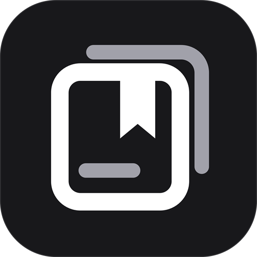

<div align="center">



# Quelyt

**本地优先、带原文出处的教材自学与论文精读客户端**


[核心特点](#核心特点) · [功能概览](#功能概览) · [下载安装](#下载安装) · [验证状态](#验证状态与已知边界) · [本地构建](#本地构建与测试) · [仓库结构](#仓库结构)

</div>

---

## 核心特点

Quelyt 面向需要围绕真实教材、学术论文与习题开展长期深度学习的场景。所有资料副本、OCR 文本、全文检索索引、独立笔记、复习调度与排课日程均保存于本机：

- **离线即用**：无需账号登录，也不强制配置 API Key，即可完成导入、原页阅读、本地 OCR、FTS5 检索、原文校对、Markdown 笔记、手动/自动排课与自评复习。
- **原文可回溯**：笔记摘录、全书问答引用、复习候选题与每日课程均绑定文档 SHA-256、物理页码和选区坐标，随时一键回到原页核对。
- **可控的 AI 边界**：自带兼容 OpenAI Chat Completions 的文本/视觉模型 API Key，写入系统受保护凭据库（不进 SQLite，也不进入整库备份）；每次调用前展示完整发送预览，图片授权仅限当次请求。

## 功能概览

| 模块 | 主要能力 |
| --- | --- |
| **资料库与文件管理** | 统一导入队列（文件/文件夹选择器＋系统拖入）、SHA-256 去重、多级彩色文件夹树、快捷方式、标签/星标、智能文件夹、浮层操作菜单、回收站批次/单项恢复、原件导出、`VACUUM INTO` 整库备份与校验恢复、存储清理与原件重链 |
| **原页阅读与 OCR** | PDF / JPG / PNG 原页阅读（缩放、旋转、框选、物理页跳转、阅读位置恢复）、随包中英文 Tesseract OCR、SQLite FTS5 全文检索与人工校对 |
| **教材问答与整书理解** | 章节（可编辑）/分块/知识点/全书概览索引、全书多路检索、DeepSeek 官方 Search / Fetch 联网补充（限流与 7 天缓存）、原页框选图片问答、教材出处/网络参考分列与独立教材会话 |
| **独立笔记系统** | 独立于教材生命周期的全局笔记工作区、6 类模板、700 ms 自动保存（带修订号防覆盖）、Markdown 工具栏与预览、来源回跳卡片、共享文件夹与标签、全文检索、待解决问题、历史快照恢复、回收站与导出 |
| **复习系统** | FSRS v5（默认 19 权重）记忆调度与考前专题训练双模式；今日队列/错题/待核对/全部/统计 5 视图；可断点恢复的独立复盘会话、主动回忆、4 档评分与撤销、可选 AI 判分建议与人工核对（`review_checks`）、候选题审核入库 |
| **日程与 AI 排课** | 周一开头月历、可折叠日详情、列表与学习路径视图；手动任务与个人占用、每周重复（最多 366 天）、冲突定位、确定性本地排课（支持撤销）；材料目录、知识点提取与每日课程；年/月/日选择器、前后切日、「跳转」弹窗（输入表达式或数字推算/年月日数字双模式）与桌面端内嵌 AI 规划对话栏 |

## 下载安装

请前往右侧 **Releases** 页面获取最新预发布软件包：

- **Windows x64（便携版）**：下载 `Quelyt-*-windows-x64.zip`，完整解压至任意目录后运行 `local_study.exe`（请保留同级 DLL、`data/` 与 `ocr/` 目录）。
  - 如需从源码一键覆盖安装到 `%LOCALAPPDATA%\Programs\Quelyt` 并自动备份旧版本与本机数据目录，可使用 `scripts/install-windows.ps1`。
- **Android arm64（开发体验版）**：下载 `Quelyt-*-android-arm64-development.apk` 安装体验（当前采用开发调试签名）。
- **校验文件**：随 Release 一并提供 `SHA256SUMS.txt` 用于核对下载完整性。

## 验证状态与已知边界

### 已验证基线（2026-11-13）
- **静态分析**：`dart analyze lib test` 退出码 `0`（0 错误、0 警告，仅 1 条既有的 `test/notes/notes_migration_test.dart` `dispose` 弃用提示 `info`）。
- **自动化测试**：`flutter test` **337 项通过、0 项失败**；另有 1 项依赖外部真实密钥的联网测试默认跳过（`test/book_qa/live_book_qa_test.dart`，需显式设置 `BOOK_QA_LIVE=1` 与 `DEEPSEEK_API_KEY`）。
- **双端构建**：已完成 `0.3.0-dev+33` Windows x64 Release 构建与本机安装验证，以及 Android arm64 Release APK 构建。

### 尚未完成的验收范围
- 真实模型服务商的长期回答与排课质量评估、真实 DeepSeek 账号 Search / Fetch 长程联调；
- Android 真机完整交互与系统文件拖入验收；
- 富文本 WYSIWYG 与图片附件、公式可视化编辑、笔记链接/反向链接、系统通知与系统日历（ICS）同步、以及万级资料规模压测。

## 本地构建与测试

### 环境要求
- Flutter **`3.47.9`** / Dart **`3.13.7`**（脚本优先使用工作区 `.tooling/flutter`，否则回退系统 PATH）
- **Windows**：Visual Studio 2022 C++ 桌面开发工具链、ATL 与 Windows SDK
- **Android**：JDK 17 与 Android SDK

### 常用命令

```powershell
# 运行代码检查与全部离线测试
./scripts/check.ps1

# 构建 Windows Release 产物（输出至 build/windows/x64/runner/Release/）
./scripts/check.ps1 -Task windows

# 打包便携 ZIP 并安装到 %LOCALAPPDATA%\Programs\Quelyt（自动备份旧版本与数据）
./scripts/install-windows.ps1

# 构建 Android arm64 APK（输出至 build/app/outputs/flutter-apk/app-release.apk）
./scripts/check.ps1 -Task android

# 运行 Windows 原生 OCR 冒烟测试
./native_ocr/windows/smoke-test.ps1
```

> 若本机 PowerShell 执行策略禁止运行脚本，可附加 `-ExecutionPolicy Bypass`：
> `powershell -NoProfile -ExecutionPolicy Bypass -File .\scripts\check.ps1 -Task windows`
>
> 当本地工作区位于含中文字符的路径下时，`scripts/check.ps1` 会自动在临时目录建立纯 ASCII 目录联接，避免部分原生构建工具链出现路径兼容问题。

## 仓库结构

为兼容已有本地资料与系统凭据绑定，内部包名与系统应用支持目录保留 `local_study/`；SQLite 数据库按 `v1 → v10` 顺序迁移，每步迁移前自动执行 `VACUUM INTO` 备份与完整性校验。第三方组件及 OCR 运行库许可统一保存在 [licenses/](licenses/) 与 [assets/ocr/LICENSE](assets/ocr/LICENSE)。

| 目录 / 文件 | 说明 |
| --- | --- |
| `lib/core/` | 核心数据模型、SQLite 存储、`v1 → v10` 顺序迁移与 FTS5 索引 |
| `lib/features/library/` | 资料库导入队列、文件夹树、快捷方式、标签、回收站、导出与备份修复 |
| `lib/features/notes/` | 独立笔记模型、自动保存控制器、来源卡片、Markdown 编辑/预览与版本历史 |
| `lib/features/book_qa/` | 教材整书理解、多路检索、联网补充契约与教材独立问答面板 |
| `lib/features/review/` | FSRS v5 与专题训练调度、复盘会话、AI 核对与错题统计 |
| `lib/features/schedule/` | 日程与 AI 排课、材料目录、知识点提取、每日课程及日期跳转弹窗 |
| `lib/services/` | 文档读写、PDF/图片渲染、原生 OCR 封装、共用 AI 传输与 Search/Fetch 适配 |
| `lib/ui/` | 全局导航壳层、阅读器与学习面板、设置弹窗及 Folio Line 线性图标体系（`QIcons`） |
| `native_ocr/`、`assets/`、`licenses/` | Windows/Android 原生 OCR 桥接、随包 OCR 模型/品牌资源与第三方开源许可 |
| `scripts/`、`.github/` | 本地构建安装脚本、GitHub Actions CI 工作流与 Issue/PR 模板 |
| `test/` | 存储、迁移、检索、AI 安全契约、图标规范及各模块 UI 回归测试 |

## 相关文档

- [更新记录](CHANGELOG.md)
- [产品与设计企划](企划.md)
- [资料库与文件管理实现说明](docs/资料库实现说明.md)
- [笔记实现说明](docs/笔记实现说明.md)
- [教材问答实现说明](docs/教材问答实现说明.md)
- [日程实现说明](docs/日程实现说明.md)
- [OCR 实现与完整性](docs/OCR.md)
- [首版验收基线](docs/首版验收.md)
- [公开归档清单](docs/公开归档清单.md)
