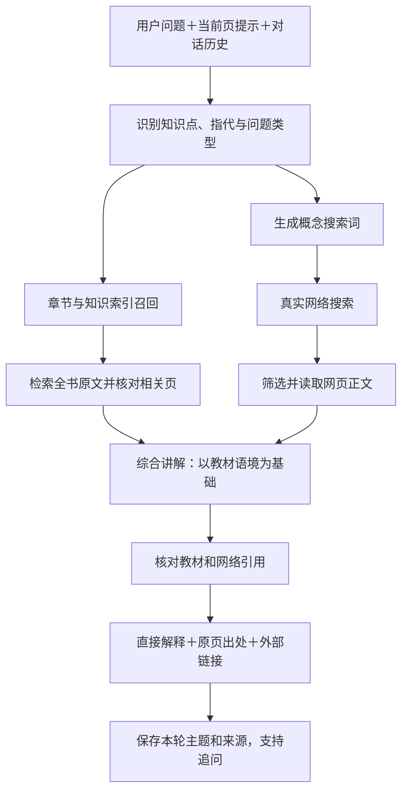

# Quelyt 教材问答调整方案

日期：2026-11-07（方案）· 2026-11-08（实施）。状态：Q01–Q07 已实施并通过本机离线回归；Q08 的教材会话与界面已完成，与日程知识点共享未接线；Q09 真实账号联调待执行。实现边界、文件位置与真实账号入口见 [教材问答实现说明](docs/教材问答实现说明.md)。

## 1. 按最新需求确定目标

**用户将教材交给 Quelyt 后，AI 应建立对整本教材的结构化理解。无论用户停在哪一页，提出关于这本教材的知识问题，都应能从全书查找相关内容，并结合真实网络搜索解释清楚。**

默认流程为：**理解整书 → 识别问题及教材语境 → 检索全书 → 搜索并阅读外部资料 → 综合讲解 → 提供教材页码和网络出处 → 继续追问。**

当前页用于理解“这里”“这个公式”“刚才的例子”等指代，也可以作为优先参考；它不再限制普通问答的知识范围。用户不需要先判断答案在哪一页，也不需要每次选择“本次页段”才能问清原因。

这次不以一个脱离教材的通用聊天框作为完成标准，也不把“模型凭已有知识补充”当作“联网搜索”。模型已有知识可协助解释和推理，实际查过的网页才展示为网络来源。

### 1.1 用户会看到的变化

| 操作 | 调整后的行为 |
| --- | --- |
| 导入或选中一本教材 | 可“建立教材理解”，查看逐页解析、章节梳理、知识点整理的进度；结果本地保存 |
| 在第 10 页问第 80 页相关知识 | 自动从整本书检索，不要求手动跳到第 80 页 |
| 书上只有结论，问“为什么” | 解释结论的条件与机理，结合外部资料补足；不给一句“本页未说明”就结束 |
| 问“这个结论和前面某章有什么关系” | 联合检索多个章节，按教材的术语和顺序组织解释 |
| 问“有没有例外／现实案例／最新研究” | 执行相应搜索，区分教材结论、外部补充和时效性信息 |
| 问“作者到底有没有这样说” | 严格核查教材；外部资料不能证明作者写过某句话 |
| 继续问“那为什么不是头头相连” | 保留当前教材、知识点和上一轮讨论，承接解释 |
| 网络搜索失败 | 仍给出能支持的书内解释与明确标注的补充判断，同时说明联网未完成；不伪造搜索来源 |

## 2. 现有问题的根因

本次根据工作区当前开发版本阅读源码，定位到以下限制。这是产品规则共同造成的行为，不能只替换一句提示词。

| 位置 | 当前规则 | 必须调整的方向 |
| --- | --- | --- |
| `lib/services/ai_gateway.dart` 的 `_systemPrompt()` | 全任务共享“只依据本次 evidence 与图片”的要求，片段没有原因就标记不足 | 教材问答采用“整书为基础、允许联网补充”的独立策略；作者原意核查保持严格 |
| `lib/app_controller.dart` 的 `evidenceFor()` | 默认只搜索当前页或选区；另一选项限定当前学习页段 | 普通知识问题默认检索全书，当前页只是上下文提示 |
| `AiGateway._parseResponse()` | 没有本地引用或没有材料时，即使正文有效，也强制判 `insufficientEvidence` | 分开判断教材覆盖、网络证据与回答完整度 |
| `StudyController._conversationFor()` | `insufficient=true` 的历史被排除 | 教材没写但解释有效的回答应可继续追问；历史仍不能充当原文证据 |
| `SavedReply`、问答卡片 | 只保存本地 Evidence，统一显示“依据不足，请回看原文” | 支持书内和网络两类来源及不同失败状态，避免用同一提示处理所有情况 |
| 当前网络服务 | 仅有模型聊天请求；`searchTerms` 只是生成检索词 | 增加真实 Search／Fetch 调用和来源记录，不能靠提示词声称已经联网 |
| `MaterialCatalogService.extractPlan()` | 面向日程计划关联材料；默认最多 40 个片段，并报告截断 | 可借鉴其取材方式，但不能直接把该结果当整书理解完成；需要独立的全书分批任务 |

## 3. “AI 读懂教材”具体怎样实现

采用 **全书解析＋分层知识整理＋提问时回查原文**。所有页面都进入解析任务，AI 按章节逐批理解，产出可复用的教材知识索引；每个问题再带入最相关原文和外部资料。用户不必每轮重新上传整本书。

### 3.1 一次建立、持续更新的教材档案

| 层次 | 保存内容 | 用途 |
| --- | --- | --- |
| 原书 | 文档 ID、文件哈希、书名、版本、总页数 | 确认回答依据的是哪本、哪一版 |
| 页面 | 文字层／OCR、物理页、原页区域、识别状态和修订号 | 原文回跳，发现缺页与公式问题 |
| 章节 | 目录、页段、标题层级、人工修正 | 确定问题属于哪一章，支持跨章检索 |
| 章节内容摘要 | 本章主题、定义、结论、适用条件、典型题型，逐项关联原文 | 帮助模型理解整书结构与教学重点 |
| 知识点 | 稳定 ID、术语、英文别名、符号、概念关系、前置知识、原文位置 | 识别同义提问和跨章节联系 |
| 全书概览 | 学科范围、章节关系、教材采用的定义和约定 | 保持全书语境，不把每次问题当孤立聊天 |

章节摘要和知识点是检索辅助，不自动升级为“教材原文”。正式回答中的教材引用最终必须回到原页，而不是只引用 AI 生成的摘要。

### 3.2 建立教材理解的步骤

1. **选择目标教材。** 不依赖是否创建日程计划；一本教材可供问答和日程共同使用知识索引。
2. **建立页级清单。** 每页记录待解析、已提取、需要 OCR、失败或需要核对。封面、空白页等可以明确标注跳过，不用一个含混的“100%”掩盖遗漏。
3. **逐页提取正文。** 复用现有 PDF／OCR 能力；扫描页按队列处理，支持暂停和重启。文字层有页眉但正文是图片时仍需识别其缺口。
4. **建立章节目录。** 优先读取 PDF 目录，辅以目录页分析；没有可靠目录时按页段建立临时章节，允许用户调整。
5. **按章节分块理解。** 每个块保留源页、证据 ID、前后文和解析版本；每批独立保存结果。超过任何上下文或批次数量上限时继续下一批，不静默丢掉后半本。
6. **归并知识点。** 去重同一概念，保留不同章节的定义差异和条件；建立前置／相关关系。模型无法确定的关联保留待核状态。
7. **合成全书概览。** 只总结已处理章节；清楚列出未完成部分。界面分别显示“页面解析完成度”和“知识整理完成度”。
8. **增量更新。** OCR 校正、目录调整或教材换版时，只重建受影响块和关联摘要。旧回答保留当时使用的证据快照，不把历史出处悄悄换成新版。

图表和化学结构式需保留原页锚点，OCR 文字不能代表已经读懂图像。视觉理解按需要补充：建立教材理解时可显式选择包含哪些图页；提问遇到未理解的图，再使用现有预览路径分析对应图片。没有处理过的图，不宣称全书图文都已理解。

### 3.3 在理解任务未完成时也可使用

用户可以边处理边提问。系统使用已解析页和可用知识索引，并显示“教材仍有部分章节待处理”；命中尚未处理的关键页时优先处理这些页，再继续本次问答。不能把“还没解析到”说成“书中没有讲”。

首次 AI 理解会把选定教材的文字按批发送给用户配置的模型。启动前展示书名、页段范围、待处理量和预算；一次确认允许执行这个有界批次，不逐页弹窗。资料原件、索引和理解结果本地保存，但不能继续宣传为“整书理解完全不出网”。取消后停止后续批次，已成功的结果可续用。

## 4. 每次提问怎样找答案

### 4.1 全书检索

- 默认取材范围为当前绑定教材全书。选区与当前页参与问题消歧和排序，不截断检索范围。
- 先查知识点名称、别名和章节，再检索原文；例如“键连”“键接”“头尾连接”“head-to-tail”作为相关表达处理。
- 现有 FTS5 作为基础召回；补充概念别名、问题拆解、章节扩展和相邻段落。长问题不能只做全句字面匹配。
- 对“为什么”至少尝试查找定义、结论和机理／条件，而不是只命中重复结论的那一行。
- 对跨章问题允许取多个章节，去重并适量扩展上下文。无关片段不为了凑数量填进请求。
- 首先通过固定样例验证概念索引与 FTS 的召回质量；若同义或跨章问题仍显著漏召回，再加入多语种向量检索。验收不因暂不引入向量库而降低。
- 对“全书有没有提到某事”区分“目前未检索到”和“全书范围已充分核查”；不能从少量召回结果推断不存在。

### 4.2 联网策略

默认开启“教材＋联网补充”。教材只给结论的原因题、例外题、跨知识联系题和时效性问题必须尝试搜索；简单摘录／翻译可直接用书内材料，并显示本轮未联网。用户可切换“仅依据教材”完成作者原意核查，或临时关闭联网。

1. 从问题提炼概念、教材中的术语和必要条件，生成最多两条互补搜索词。优先用中文；专业术语必要时补英文。
2. 搜索候选来源，按问题相关性、原始性、可读正文和发布日期筛选。课程讲义、大学教学材料、原始论文和机构文档优先；域名或排名本身不等于结论可信。
3. 阅读选中网页正文。只得到摘要时记录为“仅摘要”，不能假装阅读全文；关键机理不能只靠一个搜索摘要支撑。
4. 将外部解释与教材中的单体、机理、假设和术语对齐。发现适用条件不同要讲清，不能把其他聚合机理的结论直接套进当前课本。
5. 重要或容易误解的外部结论尽量交叉核对。没有足够可靠材料时降低结论强度，说明具体缺少什么，而不是编造比例或实验数据。

网络搜索只发送必要的概念查询，默认不携带整页教材、完整书名、用户笔记或学习记录。最终生成模型可以收到本次已选择的教材片段与网页片段，两者用途和接收方分别显示。

### 4.3 本次提问的示例

用户：“为什么聚合物多以头尾键连为主？”

系统应先从教材语境判断其讨论的是哪类聚合。例如课本讲的是常见乙烯基单体的自由基聚合，回答应直接解释：头尾取向通常兼有较有利的位阻条件和活性中心／过渡态的电子稳定因素；结合 `CH₂=CHR` 示意链增长中如何形成这种连接，并指出具体选择性取决于单体与机理，不能推广为所有聚合物的无例外定律。

回答组织建议：

1. 先给出两项主要原因和适用范围。
2. 用课本采用的“头”“尾”定义解释连接方向。
3. 结合一个小例子，分别解释空间阻碍与电子稳定作用。
4. 说明为什么仍可能存在少量其他连接，以及不能凭空给出比例。
5. 正文对应处提供教材页码；外部机理解释附真实读取过的网页来源。

德克萨斯大学的课程材料从氯乙烯加成过渡态的稳定作用和位阻解释这一取向，可作为本例外部来源之一；它不是用户教材的内容，正式产品中需分别标注。[课程原文](https://research.cm.utexas.edu/nbauld/polymers.htm)

原来那句“本次资料片段未说明原因”，最多可以转为一句背景说明：“书上这里给出了主要连接形式，下面补充它的形成原因。”它不应占据回答主体，更不能成为终止解释的理由。

## 5. 联网接口选型：先接通当前使用的 DeepSeek

调研日期为 2026-11-07。当前 Quelyt 只有聊天请求，不会因为选择 DeepSeek 模型就自动执行网络搜索。

### 5.1 DeepSeek 官方 Search／Fetch

官方提供独立的 Search 和 Fetch JSON 接口，使用 DeepSeek API Key 的 Bearer 认证。建议直接接入这条路径，复用用户已配置的官方 DeepSeek 凭据；具体账号的可用性与计费在实施时单独验证，不把文档支持等同于本机已经测通。[官方接入指南](https://api-docs.deepseek.com/guides/search/)

| 接口 | 实施方式 |
| --- | --- |
| `POST https://api.deepseek.com/v1/tools/search` | 传入概念查询，初始 `count=5`、`need_content=true`；查询字段按官方 1–128 个 Unicode 字符限制验证。解析 title、url、summary、content 等字段。[Search API](https://api-docs.deepseek.com/api/search/) |
| `POST https://api.deepseek.com/v1/tools/fetch` | 对搜索已发现且缺正文的重要页面传入 URL，取得 Markdown 正文后再选片段；不可把空正文算读取成功。[Fetch API](https://api-docs.deepseek.com/api/fetch/) |
| 最终回答 | 继续使用当前 Chat Completions 接口，把书内和外部证据分别装入请求，由问答专用契约解析结果 |

工程上使用明确的服务路由，不把 `/v1/tools/search` 填进原有“模型接口地址”输入框，也不对该路径自动追加 `/chat/completions`。读取现有凭据时保持原账户标识；凭据只发送到已配置并验证的官方服务地址，不发送给搜索结果网页。

Search／Fetch 按请求单独计费，最终回答另计模型用量；界面分别累计两项，不拿聊天 token 数推算全部费用。具体费率以用户使用时的官方价目为准。[官方计费说明](https://api-docs.deepseek.com/quick_start/pricing/)

### 5.2 其他模型的兼容方式

定义统一 `WebSearchProvider` 接口，第一轮实现 DeepSeek 官方适配器。自定义“兼容聊天接口”不代表支持同样搜索 API，未经验证不得自动尝试官方地址或借用另一家的 Key。

阿里云百炼在部分模型／接口支持 `enable_search` 等联网机制，后续可适配，但需要分别处理来源返回和模型限制，不能向所有服务商发送相同参数。[百炼官方联网文档](https://help.aliyun.com/zh/model-studio/web-search)

搜索能力不可用时明确显示“联网未配置／本次搜索失败”。仍可用教材及模型知识提供有标记的回答，但这属于降级路径，不能拿它作为“教材＋真实联网”验收成功。

## 6. 回答、来源与状态一起调整

### 6.1 问答独立契约

新增教材问答任务，例如 `AiTask.bookQuestion`，普通问答输入切换到它。它拥有独立提示词、证据包与响应解析；原有出题、评阅、论文导读不共用“允许任意补充”的默认策略。

建议响应对象 `BookQaResult`：

| 字段 | 用途 |
| --- | --- |
| `answerStatus` | answered／partial／needsClarification；表明问题回答到了什么程度 |
| `blocks` | 正文段落、支持它的书内或网络证据 ID，以及明确标识的推理／补充 |
| `bookCoverage` | 本次检索范围、全书解析状态、已命中的章节与缺口 |
| `webStatus` | searched／cached／notNeeded／disabled／failed；由客户端实际任务记录决定，不让模型自报 |
| `missingInformation` | 真正影响回答的未知条件，例如未指定聚合机理，而非泛泛“教材没写” |
| `usage` | 理解问题、搜索、读取、生成回答分别记录请求数和用量 |

来源注册表由客户端建立：书内 `B…` 记录文档版本、物理页、原页区域、文字快照；网络 `W…` 记录标题、原始 URL、内容片段、获取时间、可选发布日期和正文／摘要状态。模型只引用本次注册的 ID，客户端生成可点击页码与网址。

### 6.2 解除错误限制，保留正确核对

- 普通知识问答不再因为“没有本地页码引用”就判失败；若机理来自可靠网络页面，可以正常回答并标注外部依据。
- 教材出处只能支持教材真正写过的内容；网络内容不能伪装成本书某页，模型推理不能标为作者原话。
- 无效引用不成为可点击链接，相关主张降为待核或重新组织回答；“ID 存在”也不等于证据确实支持结论，需要内容抽检。
- 真正无法确定的数值、具体题目条件或实验结果仍需要补问或查证，不为了“回答任何问题”编造。
- 出题和评阅继续按选定学习目标与证据约束，避免放宽普通问答后错误推进练习或掌握状态。

### 6.3 追问与教材会话

为教材问答建立独立 conversationId，绑定教材及其版本。翻页、改变当前学习小节不会自动清空这条教材对话。切换另一本书默认切换教材会话；用户明确选择跨书比较时再加入其他书。

保留有效的外部补充回答用于追问；历史只负责承接上下文，不作为新的原始证据。再次使用旧网页时按缓存策略记录为缓存来源；问最新信息时重新搜索。请求提交后翻页不丢结果，结果保存回原 conversationId，不误写到新打开的书或练习任务中。

## 7. 界面与费用控制

保留用户设计的问答页面，只调整必要信息：

- 原“当前页／本次页段”不再作为普通问答的唯一范围开关；默认显示所绑定教材和“全书＋联网”，高级选项保留指定范围或仅教材核查。
- 生成中显示“查找教材 → 检索网络 → 阅读来源 → 整理回答”，提供取消，不用单一转圈掩盖长任务。
- 回答以直接解释为主，必要处附小型来源标记。下方分别列出“教材出处”和“网络参考”，来源详情可展开。
- 书内未命中、扫描页未完成、网络失败、问题条件不清分别提示；取消通用的“依据不足，请回看原文”一刀切警告。

初始任务预算建议：每题最多两轮书内召回、两次网络查询、三个额外网页读取，再生成一次最终回答；超出预算给出“继续深入查找”的显式动作，不无限调用。教材摘要、已核对知识点、书内检索及可复用网页片段按版本缓存。

回答输入按相关性分配给教材原文、章节背景、网页片段与最近对话，并按模型窗口设上限。不能把整本书和整页网页每轮重复发送，也不能因为使用了小上下文就说只理解了当前页。

默认发送前展示已选教材范围、搜索词、服务商和本轮调用上限，允许一次执行本轮有界流程。后续检索得到的网页会加入最终回答上下文，因此预览须明确这是包含搜索结果的流程授权，不能声称用户已预览尚未获取的全部文本；完成后可查看实际使用来源。新增教材、发送图片或扩大授权范围时重新确认。

教材和网页中的内容都作为待分析资料，不能指挥应用读取其他本地文件、泄露 Key 或修改日程。请求失败、取消和晚到结果不影响教材原件、学习记录或现有日程。

## 8. 模块与实施顺序

| 步骤 | 具体工作 | 建议位置／产物 | 完成标志 |
| --- | --- | --- | --- |
| Q01 固定本例及回归样例 | 保存“书中只有结论、原因在其他章／网络”的合成材料；定义新问答任务、来源和状态 | `test/book_qa/`、问答契约 | 能复现当前错误限制；旧出题／评阅测试不改为放水 |
| Q02 分离问答策略 | 增加 bookQuestion 专用提示与解析，分离书内不足和回答不足；支持网络来源模型 | `lib/services/ai_gateway.dart` 或独立 `book_qa_client.dart` | 可靠外部解释可正常展示；严格任务仍保持原证据规则 |
| Q03 建立存储与迁移 | 新增教材理解、问答消息、来源快照与任务表；为日程共享知识点保留稳定 ID | 现有顺序 migrations、新仓储；旧 SavedReply 兼容读取 | 旧问答不丢；迁移可回滚；不借用 planning_messages 储存教材聊天 |
| Q04 建立教材理解任务 | 按书而非按日程建解析队列、章节、分块、摘要、知识点及持久化进度 | `lib/features/book_qa/services/book_understanding_service.dart` | 所有页有处理状态；40 块等上限不造成后半本无声遗漏；重启能续跑 |
| Q05 建立全书检索 | 用章节／概念辅助 FTS，加入别名、跨章召回、相邻上下文和证据覆盖 | `book_retriever.dart`、现有 `search_index.dart`／LocalStore | 在不相关页提问仍命中相关章；可回到正确原页 |
| Q06 接通真实搜索 | 实现 DeepSeek Search／Fetch 适配、路由白名单、响应解析、预算、缓存和错误状态 | `web_search_provider.dart`、`deepseek_search_provider.dart`、共用 transport | 真实调用能返回并读取页面；未调用时绝不显示“已搜索” |
| Q07 串起完整问答 | 识别问题、全书查找、生成查询、筛来源、读取正文、综合与校验引用 | `book_qa_service.dart` | 用户示例得到有机理、有条件、有来源的解释，且不只复述结论 |
| Q08 接入会话与页面 | 稳定教材 conversationId、跨页追问、引用卡片、进度、取消和晚到回复隔离；连接日程共享知识点 | `book_qa_controller.dart`、`learning_panel.dart`、`study_app.dart`、请求预览 | 翻页后可继续问；两类出处可用；历史可重启恢复；日程不重复理解同一本书 |
| Q09 验收与实测调整 | 运行下节样例，真实模型＋搜索端到端核对，记录时间、费用及缺口 | 功能验收报告 | 核心案例和跨页／跨章／网络路径通过后，才视为本次调整完成 |

实现时从工作区最新数据库版本追加迁移，不能照搬此前方案中的 v1→v2 版本号。新知识库涉及页面文本、摘要、来源缓存和网络记录，删除教材时应同步按既有删除政策处理关联内容；不得留下未声明的教材副本。

Q02 可先改善回答策略，但它只是中间结果。**完成 Q03–Q08 的整书与真实搜索链路，才达到用户这次明确的目标。** 网络能力必须进入本轮核心范围，不能只列为未来选配。

## 9. 验收用例与通过条件

| 场景 | 必须出现的行为 |
| --- | --- |
| 本页只有“头尾连接为主”，没有原因 | 自动查全书并搜索外部机理，实际解释原因；不以“本片段未说明”结束 |
| 换到不相关页面问同一个知识问题 | 核心概念、适用条件和教材依据一致；允许文字表达不同 |
| 原因位于后半本／另一章 | 召回正确章节并能回跳；不能只从前 40 块取证 |
| 问前后章的关联 | 使用两个章节相关证据，解释真实联系 |
| 扫描页尚未完成 | 明确处理缺口，优先补相关页；不说教材没有该内容 |
| 只有图中的结构式决定结论 | 使用已处理图证据或请求补充图像分析，不根据乱码猜结构 |
| 网络提供的解释与教材条件不同 | 识别机理、对象或假设差异；不把不同条件下的结论当矛盾强行合并 |
| 查询最新研究／数据 | 真正搜索，注明来源时间；使用缓存时不冒充刚检索 |
| 断网、空结果、正文抓取失败 | 分别说明状态，保留可用解释；不生成虚假网址或“已阅读”标签 |
| 要求“只说明作者说了什么” | 严格书内核查；不能用外部补充冒充作者主张 |
| 追问“那头头连接为什么少” | 承接原知识点，必要时补检索，保留来源区分 |
| 取消、切书、重启或重复发送 | 不串会话，不污染练习，不自动无限重试，不丢已完成回答 |
| 教材或网页含要求泄露数据的文字 | 不执行其操作指令，仍按用户问题取证 |

建立至少 20 道有人工核对依据的问题，覆盖定义、原因、计算、跨章联系、图表与时效性；其中至少 6 道在与答案无关的页面发起，至少 5 道需要外部补充。每题标注应命中的章节／页段、回答要点和可接受外部证据，不能只看文字是否流畅。

通过门槛：跨页书内检索相关样例全部命中人工标注依据；所有可点击出处都来自本轮实际证据或明确标注的缓存；外部补充不冒充教材；用户提供的头尾连接案例必须完整解释并核对来源。模型回答内容正确性需人工评阅，接口成功和 mock 测试不替代这项验收。

## 10. 预估工作量

以当前已具备 PDF／OCR、FTS、日程材料处理和共用 AI transport 为基础，一名熟悉现有 Flutter 项目的开发者初估：

- 问答契约、来源与分流：2–3 人日。
- 整书理解与全书召回：4–6 人日。
- 搜索／网页读取与综合问答：3–5 人日。
- 页面接线、会话迁移与实测：3–4 人日。

合计约 **12–18 人日**。这是工程估算，长扫描教材和图文解析的实际效果可能影响周期；第一轮用真实教材完成核心案例后再重估。若旧 OCR 无法支撑关键章节，则把该缺口作为明确依赖处理，不能靠扩大模型自由发挥掩盖。

本方案优先解决教材问答，复用已有日程底座；已延期的上一版大范围验收保持原状态，不在本次方案中声称已完成。

## 11. 实施记录（2026-11-08）

### 11.1 已完成

| 步骤 | 结果 |
| --- | --- |
| Q01 | 在 `test/book_qa/` 建立合成教材样例（书中只有头尾连接结论，原因在另一章与外部资料），含 20 道人工标注应命中页／章节／答案要点的验收问题；覆盖跨页、别名、缺页、失败、缓存、作者核查等回归 |
| Q02 | 新增独立 `BookQaClient`（`bookQuestion` 契约）；书内不足与回答不足分开判断；无引用不再自动判失败；无效引用降级；作者原话核查使用严格提示词 |
| Q03 | SQLite v6→v7 迁移、备份与失败回滚；新增理解、问答、来源与网页缓存表；旧 `SavedReply` 首次打开时导入一次 |
| Q04 | 章节（含临时章节与手工编辑）、分块、逐块摘要、知识点归并、全书概览、断点续跑、40 块上限后续跑、页面校正后的定向重建、连续失败停止 |
| Q05 | 全书多路 FTS、知识点术语／英文别名／符号、章节提示、相邻页扩展、覆盖范围与缺页区分 |
| Q06 | DeepSeek 官方 Search／Fetch 适配；固定路由与凭据边界；真实请求记录；2 次搜索／3 次读取／4 个来源预算；7 天缓存与时效题绕过；失败、空结果、仅摘要和缓存状态 |
| Q07 | 完整编排：全书检索 → 搜索 → 读取 → 综合 → B/W 来源校验；搜索失败仍用教材回答 |
| Q08 | 教材独立会话、跨页追问、切书切会话、晚到结果写回原会话、取消、理解进度与取消、问答面板、来源分列、章节编辑、空白页标记、框选原页图片的一次性授权提问；**与日程知识点共享未接线** |
| Q09 | 提供真实账号测试入口 `test/book_qa/live_book_qa_test.dart`；**本轮未执行**，不使用用户密钥，不把 MockClient 当作真实联调 |

### 11.2 与方案不同或未覆盖

- 章节识别使用页首标题启发式与临时页段，未读取 PDF 目录树；章节可在界面手工调整。
- 未引入向量检索；本轮先用固定样例验证 FTS＋知识点／章节召回，若真实教材仍明显漏召回再按 Q05 的条件增加。
- 图表和化学结构式没有纳入自动全书整理，未声称全书图文已理解。
- 与日程知识清单共享同一套知识点、日程不重复理解同一本书，尚未接线；这是 Q08 的剩余部分。
- 真实 DeepSeek 账号的 Q09 端到端、真实回答质量、Android 真机与正式签名仍未验收。

### 11.3 验证

`flutter analyze --no-pub` 无问题；`flutter test --no-pub` **245 项通过、1 项真实账号联网测试默认跳过**；Windows Release 构建成功（含 `url_launcher_windows` 插件）。真实网络与真实模型质量不在离线测试的结论范围内。
