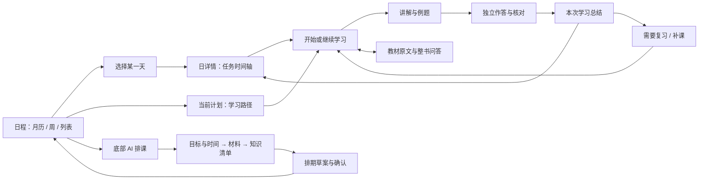

# Quelyt 日程与每日学习前端对齐方案

调研日期：2026-11-08。状态：**交付 A（F01–F05）已实施**：显式学习入口、独立课程页与返回恢复、日历/学习路径、月/列表、显示内容筛选、手动安排渐进展开；周视图与完整学习会话持久化仍属于交付 B/C。

本方案承接用户确认的“优化日程及每日学习流程”。目标是在现有 Quelyt 视觉设计上，借鉴 DeepTutor 的时间视图、学习路径和持续学习工作区，完成“制定计划 → 安排到日历 → 开始学习 → 查原文与追问 → 作答 → 记录结果 → 继续或复习”的连续体验。

**建议采用：保留月历首页、右侧日详情与底部 AI 排课入口；新增计划路径视图；将每日课程从弹窗升级为可恢复的学习页面。第一优先级是日历到课程的衔接，其次是课程内的教材问答与结果记录。**

这是一份增量方案。原有主题、字体、侧边栏和书库设计继续沿用。本文规定的是信息层级、交互行为、状态与交付步骤，具体图标、间距和视觉细节仍由现有设计体系统一。

## 1. 调研依据与边界

### 1.1 实际查看了什么

| 对象 | 本次操作或检查 | 可以据此确认的内容 |
| --- | --- | --- |
| 本机 DeepTutor 1.7.1 | 启动已有安装，通过本地页面操作 Calendar、All learning、Mastery Path、Practice | 导航、月视图与周时间网格、日程编辑面板、学习活动入口、学习目标创建、每日复习空状态 |
| DeepTutor 的目标创建 | 打开新目标，填写示例目标，进入材料选择，然后退出 | 目标与材料分步收集；创建前可以修改；本次没有提交目标，也没有调用模型 |
| DeepTutor 桌面布局 | 对照窄窗口和 1440 × 900 视口 | 窄窗口收起导航；桌面日历使用紧凑工具栏、辅助筛选区和主日历，避免把所有信息塞进日期格 |
| 本机 Quelyt 0.2.0-dev | 打开日程、展开并收起 AI 排课、打开并退出新增安排 | 现有月历、右侧日详情、340 高度排课浮层、手动安排表单的实际布局；没有新增用户数据 |
| Quelyt 当前工作区 | 阅读日程、课程、知识清单、教材问答、复习与存储相关代码 | 下文所列已有组件、入口和数据边界。代码存在不等于安装包功能已经通过验收 |
| 官方资料 | 核对 Calendar、Mastery Path、Practice、Task Board 文档 | 补足本机空数据环境无法观察的完整授课、评阅和复习规则 |

本机 DeepTutor 没有现成学习会话，聊天页也没有可选模型。因此，本次没有走通真实模型生成课程与评阅；相关结论明确归于官方文档，不宣称模型效果已验证。Quelyt 的课程内容和作答流程主要依据工作区代码分析，未向用户正在使用的数据中写入测试课程。

### 1.2 从 DeepTutor 借鉴哪些设计

| 参照 | 调研结论 | Quelyt 的落地选择 |
| --- | --- | --- |
| Calendar，实机 | 日期导航、时间视图和新建入口聚在工具栏；辅助区按类型开关信息 | 月历继续作为首页，增加列表视图；周时间网格随后补齐；学习、复习、考试、个人占用按层显示 |
| Mastery Path，实机创建流程 | 先表达目标，再选择学习材料 | AI 对话先提取目标和时间，再用简短卡片补全；教材选择放到连续流程中 |
| Mastery Path，官方说明 | 学习主题、当前知识点、目录、对话和资料保持在同一工作区；重新打开可继续 | 每日学习有固定上下文、目录、教材来源与追问；保留恢复位置。[官方说明](https://docs.deeptutor.info/explore/mastery-path/) |
| Practice，实机首页与官方说明 | 今日待复习有明确入口，先回忆再核对；自评与独立评估有区别 | 复习入口展示待处理内容；明确“自评正确／需要复习”，后续评阅另行标识。[官方说明](https://docs.deeptutor.info/explore/practice/) |
| Task Board，官方说明 | 截止日期与实际占用的学习时段分开 | 考试或任务期限显示在日期上方；每日 19:30–20:15 的安排单独显示，继续复用任务与时间块两个对象。[官方说明](https://docs.deeptutor.info/explore/task-board/) |

DeepTutor 的日历也区分任务、复习和历史活动等图层。Quelyt 只展示已有数据能够支持的图层，逐步接入复习日期，不展示尚未实现的自动执行或提醒能力。[Calendar 官方说明](https://docs.deeptutor.info/explore/calendar/)

**本轮不直接引入 DeepTutor 的服务端或完整界面。** Quelyt 仍是现有 Flutter 客户端，复用自己的本地数据、API Key 接入和阅读器。多工作区、伙伴、插件入口以及完整任务看板不属于本轮日程设计范围。

## 2. Quelyt 当前最需要调整的地方

| 优先级 | 已观察或代码可确认的现状 | 对使用的影响 | 对齐动作 |
| --- | --- | --- | --- |
| P0 | “今日课程”位于时间块的更多菜单，外侧显眼操作是“完成” | 用户先看到记录结果，难以直接开始学习 | 每项学习任务直接显示“开始学习／继续学习”，完成记录收进学习结束流程 |
| P0 | 每日课程使用最大宽度 820 的弹窗 | 长讲解、题目、答案和来源都挤在一个滚动区域 | 改为独立页面，支持目录定位、练习分步和原文侧栏 |
| P0 | 课程弹窗的“完成”只关闭弹窗，真正完成任务还需回日历操作 | 相同文案表达不同结果 | 分成“返回日程”“结束本次学习”“标记本次安排完成”，明确各自后果 |
| P0 | AI 排课目前只应用计划与可用时间，后续仍需创建任务和自动排期 | 用户说“帮我制定完整备考计划”后，仍需自行寻找后续入口 | 增加持续可见的准备进度及下一步入口，贯通材料、知识清单与排期预览 |
| P0 | 日详情底部仍提示“每日课程在下一阶段接入”，工作区已有课程代码 | 页面说明与代码状态不一致 | 在实际接通并验证入口后同步更新文案；先核对发布内容，不能只删除提示 |
| P1 | 课程讲解使用普通 Text，页码为标签 | 公式排版和回原文核对不够顺畅 | 共用可选中文本、公式／Markdown 渲染与可点击引用组件 |
| P1 | 当前课程面板没有持续追问区 | 学到不懂的地方需要离开课程 | 接入整书教材问答，保留本次学习上下文，允许跨页与联网补充 |
| P1 | 课程已有答题草稿，但缺少完整的课程位置和学习会话状态 | 恢复时能找回答案，未必能回到上一小节 | 增加课程游标、题目位置和学习会话恢复记录 |
| P1 | 知识点、计划材料和计划管理主要在不同弹窗中 | 难以看清“我已经准备到哪一步” | 统一到计划详情中的路径、材料、时间设置与记录 |
| P1 | 手动新增一开始展示较多选填字段 | 添加一个简单安排成本偏高 | 默认只展开标题、日期、时间；教材、目标、重复等逐步展开 |

代码依据：[日程页面](D:/Documents/Codex/辅助学习的agent/lib/features/schedule/ui/schedule_page.dart)、[每日课程](D:/Documents/Codex/辅助学习的agent/lib/features/schedule/ui/daily_lesson.dart)、[当前实现说明](D:/Documents/Codex/辅助学习的agent/docs/日程实现说明.md)。以上属于交互与代码检查结果，不能替代待完成的真实模型及 Android 验收。

## 3. 最终信息结构

侧边栏继续保留“书库、日程、复习”。日程内部只增加必要层级，不增加一组与现有导航重复的全局入口。



日程顶部提供“日历 / 学习路径”两个同级视图。日历负责日期与安排；学习路径按当前计划展示知识单元和进度。在“全部计划”状态点击学习路径，先显示计划卡片，选择计划后进入路径；不能把多个计划的知识点混成一张路径图。

每日学习是从任务进入的独立页面。返回时恢复入口的日期、视图、计划筛选和滚动位置。由复习进入时返回复习列表，由计划路径进入时返回该路径。

## 4. 日历与日详情怎么改

### 4.1 页面布局

下图是信息结构线框，沿用当前 Quelyt 的颜色与组件，不代表最终像素设计。

```text
┌──────────┬──────────────────────────────────────────────────────────┐
│ Quelyt   │ 日程          [当前计划 ▾]                  [+ 新增 ▾] │
│          ├──────────────────────────────────────────────────────────┤
│ 书库     │ [日历] [学习路径]   本周完成 3/8 项安排   待复习 2 题   │
│ 日程 ●   ├───────────────────────────────────┬──────────────────────┤
│ 复习     │ ‹ 2026 年 11 月 ›  今天          │ 11 月 8 日 周日      │
│          │ [月] [周] [列表]     [显示内容]   │ 已完成 1/3 · 90 分钟 │
│          │                                  │                      │
│ 最近打开 │ 月历：日期、少量安排、考试标记     │ 19:30–20:15          │
│          │ 每格最多 2 条，再显示“另 3 项”   │ 聚合物的键接方式     │
│          │                                  │ [继续学习]  ···      │
│          │                                  │                      │
│          │                                  │ 20:25–21:00          │
│          │                                  │ 练习与回顾           │
│          │                                  │ [开始学习]  ···      │
│          ├───────────────────────────────────┤                      │
│ 设置     │ ✦ 告诉 AI 你的目标或想调整的安排  │ [+ 添加这一天的安排] │
└──────────┴───────────────────────────────────┴──────────────────────┘
```

### 4.2 月历

1. 第一次进入默认月历；之后恢复用户上次选择的视图、日期和计划。
2. 保留上一月、下一月、今天，以及现有点击月份选年的交互。
3. 日期格显示日期、最多两条短安排，以及“另 N 项”。有空间再显示预计总时长，不放课程正文或多个操作按钮。
4. “今天”与“选中日期”使用不同标记；完成、待复习、逾期另配文字或图标，不能只依赖颜色。
5. 点击日期只选中并打开日详情。点击“另 N 项”也打开同一详情，不增加第二层弹窗。
6. 考试日期作为全天标记；课程在具体时段显示。个人占用用中性色，始终参与冲突计算。
7. 跨月日期可选，选择后更新月份与日详情，返回保留该位置。
8. 汇总条明确标注统计范围，例如“本周 · 当前计划”。切换筛选时同步更新，避免把全局进度误当当前计划进度。

### 4.3 列表与周视图

- 列表视图用于连续查看未来七天，按日期分组，适合任务多及小屏环境。它使用同一份时间块数据。
- 周视图按小时排列，帮助理解“每天几点到几点”。优先完成点击查看、添加及编辑；拖动改期在后续单独实现，并继续经过冲突检查与范围确认。
- 日详情已承担单日视图，本轮不额外做一个重复的全屏“日”视图。
- “显示内容”控制学习安排、复习安排、考试、个人占用、已完成项目。隐藏只影响显示，不影响冲突检测、实际排期和记录。
- 未排入日历的任务使用“待安排 N 项”入口，不假装已经占用某一天。没有真实复习日期时只能显示“待复习”，不能生成假的到期标记。

### 4.4 日详情：让下一步动作清楚

日详情首屏显示日期、任务数、预计时长和最适合继续的一项任务。优先顺序：该日尚未结束的学习会话 → 当前时间所在的未完成安排 → 该日最早未完成安排。查看历史日期时保持历史语境，不自动跳到今天。

| 任务状况 | 卡片主操作 | 其他操作与说明 |
| --- | --- | --- |
| 已有有效课程，尚未开始 | 开始学习 | 打开后不自动写完成记录 |
| 存在未结束会话或学习草稿 | 继续学习 | 恢复小节、题目与答案 |
| 绑定教材，尚无课程 | 准备课程 | 打开课程准备页，展示材料范围与模型，再确认生成 |
| 纯阅读、线下练习等无课程任务 | 开始任务 | 显示任务目标、教材入口和结果记录，不强制生成 AI 课程 |
| 已完成 | 查看学习记录 | 能重看课程；重学需明确开始新会话 |
| 材料失效 | 修复材料 | 说明缺失或版本变化；保留历史作答，不显示失效内容为当前课程 |
| 个人占用 | 查看／编辑 | 不出现课程或学习完成按钮 |

编辑、锁定、跳过、补课、删除放到更多菜单。“打开教材”作为可见次级链接。“记为完成”保留给线下学习等快捷记录场景，但不与“开始学习”争夺主操作。

### 4.5 手动安排

打开表单时先显示“学习任务／个人占用”、标题、日期、起止时间。当前计划自动带入，用户可更改。下方按需展开“学习内容”“重复与约束”“更多设置”。

绑定教材后才显示页段；选择重复后才显示星期和结束日期；个人占用隐藏课程字段。保存失败在对应字段旁解释，同时列出冲突日期及安排。重复修改继续支持“仅这次／这次及以后”，并保护已发生的记录。

## 5. AI 排课：从聊天走到真正可执行的计划

### 5.1 保留底部入口，优化展开方式

保留用户已经设计的日历下方入口。首次展开仍使用当前约 340 的浮层高度，用于一句话提出目标和简短补问。增加明确的“展开对话”按钮；手柄若显示为可拖拽，就必须实际支持拖拽调整高度。

进入较长对话或排期比较时，切换为占用布局空间的底部面板：日历缩为可滚动区域，保持可点击；日详情按可用空间收起，并在退出对话后恢复。避免长时间用遮罩挡住用户正在调整的日期。窄屏使用全屏排课页，顶部有明确返回。

对话输入区始终标明“当前计划”或“新计划”。在全部计划下不推断要修改哪个已有计划；先让用户选择。已有未提交草案时切换计划，草案留在原计划下，不随页面切换改归属。

### 5.2 以用户原始例子贯通流程

用户说：“我这个月 29 号要考试数学，帮我制定一下备考计划。”

1. **解析目标。** 显示明确年月日、科目和考试目标，避免只显示“29 号”。若日期已过，询问具体日期，不能自行顺延。
2. **集中补问。** 将确实缺少的范围、基础、每周可学时间等整理为最多三组问题；已经说过的信息预填。日期和时间可直接在卡片编辑。
3. **确认目标与时间。** 展示一张摘要卡。沿用现有计划设置草案，应用后明确提示“计划已建立，尚未排入日历”。
4. **选择教材与范围。** 从本地书库选教材、考纲或题目，显示可用页数及待处理页。可跳过材料先手动建立任务，但界面说明此时不能生成有教材依据的课程。
5. **准备知识清单。** 显示真实处理阶段与缺失页；成功部分可以检查，失败部分可重试。用户可以删除、修改目标和预计用时。
6. **生成待安排任务。** 复用已有知识点到任务的关联，防止再次点击产生重复任务。
7. **预览排期。** 显示新增、移动、保持不动、未排入四类结果；同屏展示日期、起止时间、学习方式、预计用时、材料范围和完成条件。锁定块、已开始块、已完成块不被建议覆盖。
8. **应用日历。** 使用现有草案版本检查与事务机制；应用一次即失效，重复点击不重复写入。日历变化后出现“查看第一天”和可用时的“撤销”。
9. **进入第一天。** 日详情出现“准备课程／开始学习”，无需再去计划管理中寻找入口。

上述过程使用一条准备进度：“目标与时间 → 材料 → 学习清单 → 排期”。每个阶段可返回编辑，退出后可继续。进度条表达已完成的准备步骤，不展示虚构百分比。

### 5.3 对话卡片规则

| 回复类型 | 显示与行为 |
| --- | --- |
| 补问 | 问题、短选项、自由输入；仅收集缺失信息 |
| 计划设置草案 | 日期、目标、可用时间、假设、修改入口；应用只影响列出的设置 |
| 排期草案 | 日期差异、容量缺口、未安排任务、冲突；“应用到日历”是唯一提交按钮 |
| 材料不足 | 指出哪份资料哪段不可用，并提供处理／换材料／手动安排入口 |
| 普通解释 | 普通文本，不出现会修改计划的按钮 |
| 失败或取消 | 保留输入和已完成步骤；重试从失败阶段开始；晚到结果不能应用到另一个计划 |

模型和发送范围沿用已有发送预览。课程或教材片段的发送不能继承为无限范围授权；问图继续按原有图片预览方式处理。本轮将这些说明收敛到必要的预览中，不在每个日期格重复显示。

## 6. 每日学习：本轮最重要的改造

### 6.1 从弹窗改为学习页面

```text
┌──────────────────────────────────────────────────────────────────┐
│ ← 返回 11 月 8 日日程  高分子复习计划 / 键接方式   [暂停并保存]   │
│ 本次安排 19:30–20:15 · 目标：能解释原因并画出结构                  │
├──────────────┬─────────────────────────────┬──────────────────────┤
│ 本次目录     │ [学习] [练习] [总结]        │ [教材] [问 AI]       │
│              │                             │                      │
│ 1 目标       │ 当前小节：键接方式          │ 原文页或问题上下文   │
│ 2 概念 ●     │ 讲解、结构式、例子          │                      │
│ 3 例题       │ 可点击教材出处              │ 整书范围 · 联网状态  │
│ 4 练习       │                             │                      │
│ 5 回顾       │ [上一节]        [去练习]    │ 对话历史             │
│              │                             │                      │
│ 今日其他任务 │                             │ [输入我的问题…]      │
│ ▸ 练习任务   │                             │                [发送]│
└──────────────┴─────────────────────────────┴──────────────────────┘
```

桌面空间足够时采用目录、内容、辅助面板三栏。辅助面板通过“教材／问 AI”切换，一次只有一个占用右栏；问题中的出处可以切回教材面板。需要专注阅读时可收起目录或右栏。不要同时打开计划管理、课程弹窗和多个浮层。

### 6.2 学习页面的固定上下文

- 顶部：计划名、当前任务、日历时间段、本次学习目标和返回入口。
- 左侧：本任务的讲解小节和练习进度；其他当日任务折叠在底部。
- 中间：每次聚焦一个小节或一题，允许目录跳转和连续阅读。
- 右侧：教材来源或 AI 追问，输入与历史持久保留。
- 底部或顶部动作区：当前阶段唯一主要操作，例如“开始练习”“核对答案”“结束本次学习”。

界面始终知道四件事：当前学习任务、对应课程版本、此次时间块、返回位置。拆成两天的同一个任务可复用课程；两天的实际学习记录分开，不能在第二天重新生成另一份不相关内容。

### 6.3 进入与恢复

1. 点击任务主操作后校验材料、课程版本及已有会话。
2. 课程有效时打开已保存内容；存在未结束会话时默认恢复，提示“已恢复至例题 2”。
3. 尚无课程时显示准备页：学习目标、教材页段、处理状态、模型、“生成课程”和“先读教材”。生成需要用户确认，导航本身不触发付费请求。
4. 生成中显示实际阶段，例如检查材料、读取已就绪页、生成讲解与题目、检查内容。没有后台进度值就使用不定进度条。
5. 生成失败保留输入、范围与已有有效课程；重试不会重复创建课程。取消之后晚到结果不写入当前会话。
6. 切换小节、输入答案、暂停、返回日程时保存游标和草稿。应用再次打开恢复到该课程版本对应的位置。
7. 材料版本改变时显示失效原因。旧答案与学习记录继续可查；重新生成后开启新版本，不能用题目索引强行把旧答案套给新题。

### 6.4 讲解和材料引用

每个知识小节采用“本节目标 → 核心解释 → 一个例子 → 自我检查”的结构，允许不同任务类型简化。阅读类任务可以重点展示阅读目标与原文，练习类任务优先进入题目。

正文需要支持中文、段落、列表、公式、代码或表格，以及文本选择。优先抽出共用渲染组件；若现有组件不支持公式，再单独选型验证，避免先改所有聊天页面。

来源显示为可点击的“教材 · 第 X 页”，点击在右栏或阅读器打开准确页，保留当前小节。印刷页码与 PDF 物理页不一致时同时说明。公式或图像不能可靠转写时保留原图入口，继续遵守发送图片前的预览规则。

### 6.5 课程内追问遵守此前教材问答目标

用户在讲解、练习或任意教材页都可以提出问题。**默认以整本教材为依据，当前课程和页码只帮助理解问题，不作为检索上限；网络检索用于补充解释。**

输入区显示“基于《当前教材》”，以及真实的联网可用／关闭／失败状态。问题如“为什么聚合物多以头尾键连为主”，先结合整书内容寻找依据，再按配置检索网络补充；不能仅因当前课程没写原因而结束回答。

这部分复用现有整书问答能力，课程只提供 taskId、课程目标、当前小节与用户问题。材料不足时说明覆盖范围，网络失败时说明未完成检索，同时在已有依据范围内继续解释。教材出处、网络出处和模型推导分开呈现。

练习提供两个明确动作：“给我提示”和“解释这道题”。提示逐步提供，不默认暴露完整答案；用户主动要求完整解释时可展开，并记录已经看过解答。普通知识追问继续允许跨页讨论，不被练习范围限制。

当前 [BookQaController](D:/Documents/Codex/辅助学习的agent/lib/features/book_qa/book_qa_controller.dart) 与阅读器当前文档存在绑定。接入时要显式传入任务教材及会话身份，不能让课程提问误用最近在书库打开的另一本文档。这属于必要的衔接改造，不是简单把现有面板粘贴进页面。

### 6.6 练习与反馈

1. 展示题目、学习目标和可选来源，答案默认折叠。
2. 用户输入答案，草稿自动保存；切题和查原文均不清空。
3. 点击“核对答案”后显示参考答案、解题过程和自评项。
4. 自评继续使用已有“答对了／需要复习”。选择后显示保存结果，可查看作答历史。
5. 已看答案但尚未独立完成时，允许记录“需要复习”；不能显示“AI 已判定掌握”。
6. 将来接入 AI 评阅时另设评阅结果、依据、是否存在争议和重试入口。本轮先把接口位置留清楚，不用动画或颜色假装已经有可靠评阅。

### 6.7 结束本次学习

“结束本次学习”打开内嵌总结，显示本次学到的小节、已作答题数、自评结果、实际用时与待复习项。提供三个明确选择：

- **完成这次安排**：记录当前时间块完成。一个任务分布在多天时，任务总体状态继续按所有相关时间块汇总。
- **今天学到这里**：保存本次实际进展，保留未完成部分，并可查看补课建议。
- **继续学习**：回到原小节或题目。

关闭页面或点击“返回日程”只保存草稿和暂停状态。不能因为看完正文、点击返回或展开答案就自动完成安排。

计时仅在用户开始学习后运行，支持暂停和修改实际用时。作答事件与用时分开记录，避免三道题分别自评后把同一段 45 分钟累计三次。结束提交使用唯一操作标识；连续点击、恢复应用和重试都不得产生重复时长。

## 7. 学习路径、复习与进度

### 7.1 计划路径

路径优先采用可展开的章节／知识单元列表，显示先后关系和下一步建议。先做到内容清楚、可编辑、可跳转，再考虑复杂图形；第一轮不需要可以任意拖动的知识网络。

每个单元显示：名称、目标、教材页段、预计用时、关联任务、是否已安排、任务进展和待复习数。点击可进入课程或查看安排；没有任务时提供“建立任务”；已有任务但未排期时提供“安排时间”。前置依赖保留说明，未经评估不能强制禁止用户查看后面的知识点。

计划详情包含“学习路径、材料、时间设置、记录”四个页签，复用已有数据和编辑能力。计划卡片显示考试日期、最近学习位置和未完成准备步骤。

### 7.2 三种进度分开

| 指标 | 计算口径 | 不应暗示什么 |
| --- | --- | --- |
| 安排完成 | 当前范围内已完成的学习时间块 / 全部有效学习时间块；个人占用不计入；跳过单列 | 不能表示知识掌握程度 |
| 任务进展 | 已完成任务 / 当前计划全部有效任务；拆分时间块仍只对应一个任务 | 不能用日历格数量代替任务数量 |
| 练习反馈 | 已作答题数、自评正确数、需要复习数；如果以后有 AI 评阅则另列来源 | 自评正确不能直接改名为“已验证掌握” |

学习路径第一轮使用“未开始、进行中、已完成学习、待复习”等有事实依据的标签。只有引入了独立的评估记录和规则后，才添加“掌握度”及其来源说明。

### 7.3 复习闭环

现有复习页继续作为全局入口，日程中增加当前计划的待复习摘要；两处读取同一数据，不能生成两份待办。

第一阶段直接接现有课程自评待复习项，点击后恢复对应题目与教材上下文。复习结束明确记录本次结果。第二阶段允许用户选择下次复习日期，并把已确认的复习安排显示到日历；尚未实现复习到期字段前，不标“今日到期”。

补课保留现有“给出候选时间 → 查看冲突 → 用户应用”流程。复习建议和补课建议不会自动挤掉已锁定安排，也不因用户一天未完成就重排整个考试计划。

## 8. 响应式、视觉和异常状态

### 8.1 宽度规则

以下宽度按扣除全局侧栏后的可用内容区域计算，均为 Flutter 逻辑像素，实施时用实际组件测量确认。

| 可用宽度 | 日程页 | 学习页 |
| --- | --- | --- |
| ≥ 1150 | 月历与约 340 宽日详情并排 | 约 200 宽目录、至少 560 宽正文、约 320 宽辅助区；栏间预留间距 |
| 760–1149 | 月历占主区；日详情按空间使用抽屉；AI 展开后可切换日历查看 | 默认正文与辅助区，目录以按钮展开；不足以并排时辅助区也转抽屉 |
| < 760 | 月历保持七列、日期格以摘要为主；选日后进入全屏日详情，列表视图可选 | 单列页面；底部切换学习、练习、问 AI；教材以可返回的阅读页打开 |

不要求用户手动收起侧栏才能使用核心功能。面板开关属于展示状态，不能清空任务、输入或会话。手机键盘展开后发送按钮、当前输入和返回入口仍然可见。

### 8.2 视觉约束

沿用现有主题 token、浅色背景、细分隔线和主要按钮样式。主页面不堆叠大面积渐变、装饰卡片或与任务无关的统计图。色彩用于少量状态，完成、警告与逾期同时提供文字或图标。

正文建议 15–16 号字起、行高约 1.6；日期与时间用现有等宽数字风格。点击目标至少 44 × 44，窄日期格可通过整格点击保证触控面积。键盘可切换日期和面板，焦点可见，关闭抽屉后回到触发控件。重要操作不能仅靠悬停出现。

### 8.3 必须设计的状态

| 状态 | 用户看到什么 | 下一步 |
| --- | --- | --- |
| 没有计划 | 月历仍可用，简短介绍两条入口 | AI 创建计划／手动添加安排 |
| 有计划但没排期 | 准备进度及尚缺步骤 | 继续选材料、建立任务或查看排期 |
| 这一天没任务 | 保留日期与简短空状态 | 添加安排／查看下一学习日 |
| 未配置模型 | 课程生成按钮说明前置条件，已存课程可读 | 去设置／先读教材／手动学习 |
| 材料处理中或仅部分就绪 | 显示已就绪和缺失范围 | 等待、重试缺失页、明确缩小范围 |
| 生成中 | 阶段与取消按钮 | 取消可返回，已有内容保留 |
| 网络失败或搜索不可用 | 明确失败的是生成、搜索还是保存 | 重试该步骤，已存内容和答案仍可用 |
| 课程版本失效 | 说明材料或范围变化 | 查看历史记录／生成新版本 |
| 恢复学习 | 显示恢复的小节或题目 | 继续；也可主动从头查看 |
| 草案过期或冲突 | 具体变动、受影响时间和任务 | 重新预览；保留原日历 |
| 已完成／仍需复习 | 分别显示安排结果和练习结果 | 查看记录／进入复习 |
| 本地保存失败 | 显示“尚未保存”，保留当前输入 | 重试保存，退出前提示未保存内容 |

## 9. 复用范围与必要的数据补充

### 9.1 现有能力继续复用

| 能力 | 当前代码入口 | 改造原则 |
| --- | --- | --- |
| 日历、日详情、任务操作 | [schedule_page.dart](D:/Documents/Codex/辅助学习的agent/lib/features/schedule/ui/schedule_page.dart) | 拆分展示组件，继续调用现有控制器 |
| 手动安排 | [task_editor.dart](D:/Documents/Codex/辅助学习的agent/lib/features/schedule/ui/task_editor.dart) | 改字段展开方式，保留校验和重复规则 |
| 排课对话与草案 | [planning_sheet.dart](D:/Documents/Codex/辅助学习的agent/lib/features/schedule/ui/planning_sheet.dart)、[draft_dialog.dart](D:/Documents/Codex/辅助学习的agent/lib/features/schedule/ui/draft_dialog.dart) | 增加流程协调与差异展示，保留预览／应用分离 |
| 材料、知识清单 | [plan_materials.dart](D:/Documents/Codex/辅助学习的agent/lib/features/schedule/ui/plan_materials.dart)、[plan_knowledge.dart](D:/Documents/Codex/辅助学习的agent/lib/features/schedule/ui/plan_knowledge.dart) | 提取可嵌入内容，放入计划详情和引导流程 |
| 课程及草稿 | [daily_lesson.dart](D:/Documents/Codex/辅助学习的agent/lib/features/schedule/ui/daily_lesson.dart) | 提取讲解、练习和生成控制；由页面承载，不另做第二套课程数据 |
| 原文与教材问答 | [study_app.dart](D:/Documents/Codex/辅助学习的agent/lib/ui/study_app.dart)、[book_qa_panel.dart](D:/Documents/Codex/辅助学习的agent/lib/features/book_qa/ui/book_qa_panel.dart) | 明确任务教材和返回位置，复用问答服务与引用跳转 |
| 复习 | [review_page.dart](D:/Documents/Codex/辅助学习的agent/lib/ui/pages/review_page.dart) | 统一入口，扩展复习结果保存，避免复制同一记录 |
| 排期和持久化 | [schedule_controller.dart](D:/Documents/Codex/辅助学习的agent/lib/features/schedule/schedule_controller.dart)、[schedule_repository.dart](D:/Documents/Codex/辅助学习的agent/lib/features/schedule/data/schedule_repository.dart) | 保留冲突、锁定、事务、撤销和操作去重机制 |

展示层建议按“日历区域、日详情、任务卡片、计划路径、学习工作区、课程内容、练习、学习总结、引用面板”拆分。新组件名在实施时确定；不要继续把新逻辑集中追加进现有的大型日程页面。

### 9.2 明确哪些工作超过纯样式调整

1. **学习页面导航与恢复。** 新增页面状态：入口、计划、日期、日历视图、任务、时间块、课程版本、当前小节／题目。仅用内存无法满足重启恢复，需要持久化游标。
2. **学习会话。** 设计 `StudySession`：唯一会话 ID、taskId、可空 blockId、lessonId 与版本、开始／暂停／结束、累计有效用时、当前位置。一个任务只恢复一份活动会话；用户明确重学才创建新会话。
3. **记录事务。** 练习作答保存内容和自评；会话结束保存用时；时间块完成调用现有记录通道。使用关联 ID 和唯一操作 ID，避免重复累计。迁移时保留旧记录，并区分旧版时间口径。
4. **问答身份。** 为课程适配明确教材 ID、文档哈希、问答会话及任务上下文；异步结果回写发起它的会话。切换教材不能把旧结果写入新教材。
5. **复习处理结果。** 当前 `LessonReviewItem` 是已有记录的关联视图。要实现“复习后退出待办、下次何时出现”，需增加可追踪的复习尝试／处理状态；若加入到期安排，再补 nextReviewDate 等字段及规则。
6. **计划准备进度。** 尽量从目标、材料覆盖、知识点、任务、排期草案等已存在事实推导；必须保存的只有用户草稿和阶段入口，不再保存一份易失真的重复完成百分比。

以上新增数据应写入现有迁移体系，实施前以工作区实际最高版本号为准，避免与正在开发的整书问答迁移冲突。本次不预占数据库版本号，也不把这些能力写成“只调整前端即可完成”。

## 10. 具体实施步骤

以下以单名熟悉当前 Flutter 项目的开发者估算。时间是工作量区间，开始前先确认当前分支状态；真实模型联调、Android 环境或新增渲染依赖问题可能延长。采用三次可验收交付，总体约 12–19 个工作日，不包含完整 AI 掌握度评估和复杂间隔复习算法。

### 交付 A：先让“从日历开始学习”顺畅（约 4–6 天）

| 步骤 | 具体动作 | 完成标志 |
| --- | --- | --- |
| F01 基线与状态样本 | 对照安装版和工作区版本；记录旧入口；在隔离测试数据中准备无计划、两科冲突、课程未生成、学习中、已完成、材料失效等状态；保留当前未提交开发内容 | 有状态清单与旧流程记录；后续不需要污染用户数据库来演示 |
| F02 页面结构与导航 | 拆分日历和日详情组件；建立日历／路径视图状态与统一学习入口；保存来源日期、筛选和返回位置 | 切换视图与返回不丢日期、计划和滚动位置 |
| F03 日详情主动作 | 按任务状态显示开始、继续、准备课程或查看记录；个人占用隐藏学习操作；更新过时说明 | 已有课程从选日到进入课程最多两次点击，且课程不再藏在更多菜单 |
| F04 学习页面骨架 | 将弹窗内容抽为组件并接入独立页面；创建目标、目录、学习／练习／总结三个阶段；保留已有生成和草稿能力 | 已有课程可在新页面阅读、作答和返回；旧课程记录仍可打开 |
| F05 月历与手动安排 | 收敛日期格信息，加入显示内容与列表视图；手动表单改为基础字段加展开选项 | 月历任务很多时仍可用；简单安排无需填写学习相关选填字段 |

这一交付即可单独验收，不等待联网问答面板或新复习调度完成。

### 交付 B：完成课程内学习闭环（约 5–8 天）

| 步骤 | 依赖与具体动作 | 完成标志 |
| --- | --- | --- |
| F06 会话与记录契约 | 在 F04 基础上实现 StudySession、游标、暂停恢复、结束提交去重；拆开作答与用时口径；添加兼容迁移 | 重启可恢复；多个题目自评不会累计重复用时；旧记录可读 |
| F07 教材与追问 | 接入明确教材身份的问答适配；增加原文／问 AI 面板；可点击引用；课程范围作为提示而非全书检索上限 | 任意课程页可跨页问教材知识，切换教材和晚到响应不串话；搜索失败有真实状态 |
| F08 内容与练习 | 加入正文排版、公式样例、题目定位、参考答案展开和自评反馈；保存题目草稿与看答案状态 | 学习、查原文、追问、回到作答的过程中不丢输入；自评标签准确 |
| F09 学习总结与补课 | 实现结束页、实际用时确认、当前时间块完成、部分完成、补课入口；生成短小结果摘要 | 一个页面内完成记录，返回日历立即更新；重复点击不产生双份结果 |
| F10 排课连续引导与路径 | 串起已有目标、时间、材料、知识点、待安排任务、草案；新增计划路径；对话面板支持展开比较 | 从一句考试目标走到可查看的日历安排，每一步都能继续或返回；未排入事项清楚可见 |

交付 B 中，课程内问答依赖整书问答当前实现可用。若尚未通过真实模型校验，要明确记录该依赖的验收状态，不以界面出现输入框作为通过。

### 交付 C：复习衔接、时间视图和发布前检查（约 3–5 天）

| 步骤 | 依赖与具体动作 | 完成标志 |
| --- | --- | --- |
| F11 复习入口与结果 | 统一日程摘要和全局复习列表；增加复习尝试及处理状态；可选择下次复习时间并预览日历安排 | 完成复习后状态一致；没有真实日期的项不伪装为今日到期 |
| F12 周视图与小屏 | 补周时间网格的查看和编辑；完善抽屉、单列学习和键盘遮挡；修正焦点恢复与大字体布局 | 1440 × 900、1280 × 720、390 宽及大字体状态核心路径均可完成 |
| F13 回归与交付记录 | 执行下节验收；复用已有排期、存储、问答测试；补有风险的导航／状态／去重用例；记录真实模型及 Android 结果 | 已通过、未通过与延期项分开；更新实现说明和变更记录后再进入打包流程 |

后续可选项：周视图拖动改期、自动间隔复习、独立能力评估、更多统计图。它们不阻塞本轮日程和每日学习主流程，也不以不可用按钮提前占位。

## 11. 验收场景与标准

| 编号 | 场景与操作 | 通过标准 |
| --- | --- | --- |
| U01 首次制定计划 | 输入考试目标，补充时间，选择教材，检查知识清单，预览并应用 | 日期明确；未确认前不写正式排期；应用后可直接进入第一天 |
| U02 手动排课 | 选一天，新建学习任务或个人占用，制造一次冲突 | 只需基础字段即可建立简单安排；冲突指出具体对象；不覆盖旧安排 |
| U03 从日历学习 | 选有有效课程的日期，开始或继续 | 选日后一次主操作进入；不存在必须展开更多菜单的步骤 |
| U04 中途离开 | 写半道题、打开原文、返回、退出应用再打开 | 恢复课程版本、小节、题目和草稿；返回原日期；不自动完成 |
| U05 整书追问 | 在任意课程页提出教材其他章节的知识问题 | 检索范围不被当前页截断；显示教材依据及实际取得的网络来源；无联网结果不伪装成功 |
| U06 不同教材切换 | 先问 A 教材，响应中切换到 B 的课程 | 响应回到 A 的会话；B 的问题、材料与引用不混用 A |
| U07 作答与记录 | 连续完成三题自评，结束同一次 45 分钟学习，再重复点击提交 | 三条题目结果与一次学习用时；不变成 135 分钟；时间块只完成一次 |
| U08 拆分任务 | 同一任务安排两天，第一天学一半，第二天继续 | 课程内容与历史连续；每个时间块结果独立；第一天结束不错误完成整个任务 |
| U09 课程失效 | 换教材版本或改任务页段，再打开课程 | 指明失效；旧作答可查；新旧题目与答案不错误对应 |
| U10 取消与草案变更 | 取消生成、切计划、在别处改日历，再应用旧草案 | 晚到结果不串计划；旧草案被拒绝并可重新预览；原日历保留 |
| U11 复习与补课 | 标需要复习，分别从日程和复习入口进入，完成后再查看 | 两处状态一致；新复习或补课时间经过确认，不覆盖锁定块 |
| U12 离线与无模型 | 断网读取课程、答题、手动排程；无 Key 时尝试生成 | 已有内容可用；生成说明前置条件；草稿和手动安排可保存 |
| U13 布局与输入 | 在桌面、小屏、125%／150% 系统缩放及大字体下操作 | 核心按钮可见；不横向溢出；键盘不遮发送；Tab 焦点和关闭返回正确 |
| U14 性能与长内容 | 同月展示 300 个时间块，单日 20 项，打开长课程和长对话 | 日期格限制展示量；详情可滚动；输入与切日不卡住；在基线设备记录具体耗时后设回归阈值 |

自动化重点放在状态保留、导航身份、草案版本检查、用时去重、资料失效和复习处理等会造成数据错误的地方。纯间距、颜色或文案调整使用视觉检查，不为每个低风险样式变化新增重复测试。

真实模型检查至少包含：普通文本教材、含公式的教材、扫描教材、材料不足、网络搜索失败。此处要求的是新增流程的针对性验收；此前用户已经决定延期的其他验收仍保持单独记录。

## 12. 与现有文档的衔接

- [第二版日程实施计划](D:/Documents/Codex/辅助学习的agent/第二版日程实施计划.md)：继续作为原功能、排课规则和实现顺序的依据。本方案补充页面与交互，并调整下一轮开发的优先顺序。
- [日程实现说明](D:/Documents/Codex/辅助学习的agent/docs/日程实现说明.md)：当前写明 S02–S19 已实现，真实模型与 Android／发布验收尚未完成。本次调研没有重跑这些测试。
- [教材问答调整方案](D:/Documents/Codex/辅助学习的agent/教材问答调整方案.md)：课程内追问沿用整书理解、跨页检索、联网补充的目标。课程生成、练习答案与普通自由追问分别保持各自的依据范围。
- [企划](D:/Documents/Codex/辅助学习的agent/企划.md)：保存本轮方案入口。其历史阶段描述不用于判断当前安装包的完整实现状态。

实施前首先完成 F01，随后优先交付“显式开始学习入口 + 独立课程页 + 正确返回与恢复”。这能最快改善每天实际使用的路径，并为后续教材追问、结果记录和复习提供稳定承载页面。
