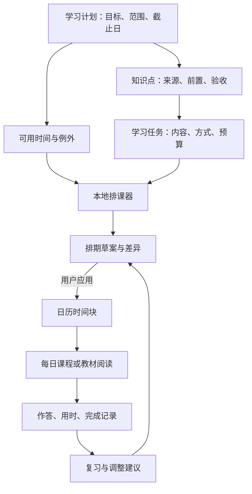

# Quelyt 第二版实施计划：日程与每日学习

编写日期：2026-11-07。目标版本：`v0.2.0`。

> **实施进度（2026-11-07）：** S02–S19 已实现并通过 170 项自动化测试（含 77 项日程、材料、知识清单、课程、复习与排课对话测试），当前版本标记为 `0.2.0-dev`。S20 的真实模型质量与 S21 的 Android 真机／发布验收尚未完成。实现范围、AI 契约边界和未完成项见 [日程实现说明](docs/日程实现说明.md)。

本文是可进入开发的实施建议，尚未实现。依据当前 `v0.1.0` / `5bde1c3` 源码、用户提出的日历交互，以及 good-learning 的教学流程制定。上一版尚未完成的真实 AI、复杂资料和 Android 真机校验继续留在原验收报告中，本轮规划不把它们当作已经通过，也不先恢复这些旧任务。

本轮实施顺序以本文为准；旧《功能校验与 DeepTutor 对齐计划》中的后续能力仍是参考积压项，其原有 0.2 分期不与本计划并行作为交付承诺。

## 1. 第二版要交付什么

从侧边栏进入“日程”，主页面显示日历，下方保留 AI 对话栏。用户可以通过自然语言或手动操作建立学习安排，点击日期查看当日任务，再直接进入教材原页或当天生成的课程。学习结果能够回到日历，并作为后续调整的依据。

验收主线：**说出目标 → 补齐必要信息 → 查看排期草案 → 应用到日历 → 点开某天 → 开始课程或打开原文 → 作答与记录 → 查看补课／调整建议。**

本轮沿用现有界面风格、字体、配色和组件，仅约定新增页面的信息与行为，具体视觉设计继续由用户决定。Windows 使用侧边栏；Android 沿用现有底部导航增加同名入口，两端共用业务逻辑，数据仍各自保存在本机。

### 1.1 建议补充的内容与版本边界

| 能力 | 第二版决定 | 为什么需要 |
| --- | --- | --- |
| 月历、每日详情、底部对话 | 必做；月历为默认视图，日期详情显示按时间排序的任务 | 覆盖用户提出的主要操作路径 |
| 完整考前排期 | 必做；从开始日排到考试前，明确每天起止时间、方法、内容和验收产物 | 避免只生成一段泛泛建议 |
| 手动创建和编辑 | 必做；无需 Key，单次与每周重复均支持 | AI 失败或离线时日程仍可使用 |
| 可用时间与不可用时段 | 必做；支持周规则、单日例外、每周学习日数、每日上限 | “每天两小时”必须能落实到真实时间段 |
| 多科目冲突避让 | 必做基础版；同一日历可有多个计划，共用时间占用检查 | 数学计划不能占掉已安排的英语时间 |
| 机动时间与漏学处理 | 必做；保留可调机动量，遗漏后给出补课草案 | 避免漏一天后整个计划失效 |
| 任务锁定、修改预览与撤销 | 必做；手动调整默认锁定，已完成记录不重写 | 让用户能放心使用 AI 重排 |
| 每日课程 | 必做；完整日程先生成，课程在用户开始该日时按需生成并缓存 | 结合最近反馈，控制等待和费用 |
| 学习记录与基础复习 | 必做；记录真实作答、用时、自评、待核对和复做建议 | 将日历和学习行为连接起来 |
| 应用内今日／逾期提示 | 必做；进入日程或恢复应用时计算 | 不依赖系统后台权限 |
| 系统通知、提醒闹钟 | 后续小版本；届时分别验证 Windows／Android | 后台提醒涉及独立的平台行为，不应拖住主流程 |
| 周时间轴、拖拽排课 | 后续增强；本版以表单编辑起止时间和日期为准 | 先保证排期与变更可靠 |
| ICS 导出、系统日历双向同步、跨设备同步 | 后续版本 | 现有产品尚无账号和同步服务 |
| 完整题库、复杂掌握度算法、全学科自动评分 | 后续版本；本版实现课程内题目和有依据的反馈 | 避免把日程迭代扩展成另一个大型项目 |
| LaTeX PDF、打印练习册、思维导图 | 后续增强；本版先在应用内呈现完整课程和数学公式 | 不要求用户安装 Python 或 TeX 环境 |

### 1.2 五项实施原则

1. **AI 提教学建议，客户端负责时间计算。** 日期是否合法、有没有重叠、能否排完、是否超出可用时间，由可测试的本地规则判断。
2. **知识清单、待学习任务和日历时间块分别保存。** 调整上课时间不改变题目身份；更新课程不伪造新的完成记录。
3. **日程草案与正式日程分开。** AI 回复可以提出修改，只有应用草案后才写入正式安排；手动点击保存则提交该次编辑。
4. **完整排期与课程正文分两次生成。** 全周期知道何时学什么，具体教学内容根据开始学习时的真实进度生成。未来某天也可主动提前生成。
5. **完成与掌握分开。** 打开课程、计时结束、阅读完成、提交答案、评阅通过是不同事实；没有作答证据时不显示“已经掌握”。

## 2. 从现有代码出发

以下是本次直接阅读源码确认的现状，不是原企划中的预期功能。

| 当前实现 | 对第二版的影响 |
| --- | --- |
| `lib/ui/shell/app_shell.dart` 的 `AppSection` 只有 `library`、`review`，桌面与移动导航共用此枚举 | 增加 `schedule`，同步处理所有 switch、侧边栏和底部导航 |
| `lib/ui/study_app.dart` 在打开文档时直接显示 `ReaderPage` | 需要记住从哪个日期／任务进入阅读器，返回时恢复日程位置 |
| `StudySession` 只有单文档页段、目标、分钟数、一道当前题与 attempts | 保留它负责原有小节阅读；另建日程、课程和题目记录，不把月计划塞进 goal 字符串 |
| `StudyController.open()` 默认恢复文档最近的 session，`beginSession()` 每次创建新 ID | 日程跳转必须显式恢复绑定的 session，不能误入另一日的学习，也不能每点一次就新建 |
| `StudyController.prepare()` 要求当前已打开文档，发送结果被绑定到文档与 session | 日程对话需要独立控制器，不能要求用户先进入阅读器才能排课 |
| `AiGateway` 当前输出契约是 answer／citations／insufficientEvidence，默认输出上限 1,600 token，最多 4,096 | 不能直接把其长回答当计划；增加独立的结构化规划、知识点和课程契约，按任务分块 |
| `LocalStore` 使用 sqlite3、WAL、schema v1，版本大于 1 会被拒绝；初始化代码最终写回 v1 | 必须先改成真正的顺序迁移，再增加新表，防止升级重置版本号 |
| 问答历史保存在 settings 中；删除资料会级联删除该资料的 sessions／notes | 新对话独立存储；资料删除必须处理日程引用与已生成内容，不能留下可点击的死链接 |
| 现有复习页读取 `StudySession.attempts` 和 `needsReview` | 新课程需要统一的复习条目适配层，避免复制假 session 只为塞进旧页面 |

第二版采用增量实现：不整体更换状态管理、数据库或阅读器；不迁移全部旧对话；只把新功能所需的公共发送能力抽出来，并保持原 91 项回归测试继续通过。

## 3. 具体使用流程

### 3.1 第一次进入“日程”

1. 显示当前月份，提供上月、下月、回到今天和手动新增。
2. 每个日期显示学习任务数量、预计总分钟数、完成数量；考试日有明确标记。休息日、无安排和资料待补不混为一类。
3. 当天任务过多时显示摘要和“更多”，不把整段 AI 回复放进日期格。
4. 下方对话栏保留当前计划上下文，可切换“新计划”或已有计划。多计划情况下，“把它推迟”必须明确指向所选任务，不能由模型任意猜测。
5. 未配置 Key 时仍可查看、创建、编辑日程；点击 AI 发送时引导使用已有服务商设置，不新增账号系统。

### 3.2 用户说：“我这个月29号要考试数学，帮我制定一下备考计划。”

1. 固定收到消息时的本地日期、时区与消息 ID，解析“这个月29号”。页面展示具体年月日。不能把已经过去或当月不存在的日期自动改成下个月。
2. 提取已知条件：数学、考试日期、备考目标；其余未知条件保持未知。
3. 集中补问真正影响排期的字段：考试范围／绑定教材、目前基础、每周哪几天和几点有空。目标分数为可选项；零基础用户不强制先做整套诊断题。
4. 允许“先给建议”：生成有清晰假设的草案，用户可修改默认时段；正式应用前必须确认日期和可用时间。没有材料时可先建立时间框架，但标记“内容待绑定”，不伪造教材章节和页码。
5. 用户从书库选择教材、考纲或真题，并指定章节／页段。现有书库暂用计划关联记录标注材料用途，不强行改动 `DocumentKind`。
6. 在本地读取解析进度。缺 OCR 页时列出待处理范围，先完成所需页段；只拿到目录时可以生成知识清单草案，不能称为已核对完整教材。
7. AI 根据选定资料提取知识点和学习活动；本地排课器把活动放入可用时段，预留机动量。
8. 显示草案：考试日、学习日数、每周频率、总可用时间、实际安排时间、机动时间、覆盖范围、未排入任务和采用的假设。
9. 用户可以继续说“周三不学”“每天最多一小时”“第一个星期先补基础”，或直接编辑表单。系统更新同一草案，展示变动。
10. 点击“应用计划”后，事务性写入计划与时间块；重复点击不会复制日程。正式日历立即显示完整考前安排。

**可验证的示例，非实际为用户排课：**固定测试时钟为 2026-11-07，用户确认 11 月 29 日考试，11 月 9 日开始，每周一至五 19:30–21:00 可学习，范围已选定。至 11 月 27 日共 15 个候选学习日、1,350 分钟可用时间；11 月 28 日无默认安排，29 日为考试标记。学习时间、休息与机动时间合计不得超出这些时段，且不会凭空增加周末课程。

### 3.3 点击某一天

1. 打开该日详情，显示日期、距考试天数、计划来源，以及按起止时间排列的任务。
2. 每项任务显示：所属科目、知识点、开始／结束、学习方法、教材范围、完成条件、当前状态和课程准备状态。
3. 一个 90 分钟学习时段可包含“回忆 10 分钟、讲解与例题 25 分钟、休息 5 分钟、练习 30 分钟、订正 15 分钟、复盘 5 分钟”。这是可编辑模板，非对所有科目都有效的固定处方。
4. “打开教材”定位到绑定文档与页段；“开始今日课程”打开或生成该任务的课程；已开始的任务显示“继续”。
5. 提供修改时间、标为完成、记录部分完成、跳过并填写原因、申请改期。操作记录真实发生时间，计划时间保留供对照。
6. 从阅读器或课程返回后仍处于原日期，保留月历月份、所选计划和滚动位置。

### 3.4 手动安排

1. 点日期或“新增”，填写标题、日期、起止时间，科目／计划／教材绑定均可选。
2. 可选知识点、学习方式和完成条件；没有材料也能创建“做纸质试卷”等任务。
3. 支持每周指定星期重复，必须有结束日期；本版最多一次展开 366 天，超出时明确提示分阶段建立，不能静默截断。
4. 修改重复安排时提供“仅这一次”“这次及以后”。已完成的历史实例不被批量改写。
5. 保存前检查时间合法性和冲突；冲突定位到具体任务，要求调整，不悄悄覆盖已有安排。
6. 手动编辑的时间块默认锁定；用户可解除锁定允许 AI 调整。已开始或已完成的任务即使解锁也不能被自动重排。

### 3.5 漏学与计划调整

1. 时间到期且未完成，只显示“逾期／待处理”，不自动标记失败或完成。
2. 用户填写“完成一半，今天没时间了”，或直接选择已完成子任务与剩余分钟数。
3. 本地排课器优先尝试机动空档，再尝试未来允许时段；无法容纳时明确显示缺少多少分钟和哪些任务未排入。
4. AI 可根据真实作答提出前置补习或复习建议，但不能自行提高每天上限、取消休息或牺牲其他科目。
5. 展示“哪些任务移动、哪些内容调整、为什么、预计增加多少时间”，应用后创建新修订。
6. 只修改尚未开始且未锁定的安排；已完成记录、原始作答和历史课程保留。支持撤销最近一次无后续依赖的应用；若后续已有学习记录，则生成恢复草案，不能直接覆盖。

## 4. 如何借鉴 good-learning

调研固定到 [good-learning 提交 1255c4d](https://github.com/yoli-mi/good-learning/tree/1255c4d7f0b602901100d29d85235ad2537eec31)。该仓库提供教学指令和文档脚本，并非可直接嵌入的日程后端。其 README 列出的 Python／TeX 运行方式与 Quelyt 的双端本地客户端不同，因此借鉴教学流程，重新实现应用内的数据与交互。[仓库说明](https://github.com/yoli-mi/good-learning)

| 参考中的做法 | Quelyt 中的对应实现 |
| --- | --- |
| 知识清单与备考计划分开，知识点有编号、来源、前置要求和验收方式 | `KnowledgeItem` 保存学什么，`StudyTask` 保存要完成的活动，`CalendarBlock` 保存何时执行 |
| 根据已有水平区分零基础与复习 | 计划保存学习模式；未知水平保持待判断，不自动给出熟练结论 |
| 当天教学按例题、逐渐减少提示的练习和独立应用组织 | 每日课程保存可渲染的教学单元，题目与解答分开显示 |
| 依据真实反馈调整后续内容 | 学习记录与评阅是观测事实；重排与补习是可审阅建议 |

对应依据：[准备与计划](https://github.com/yoli-mi/good-learning/blob/1255c4d7f0b602901100d29d85235ad2537eec31/references/prepare-and-plan.md)、[每日学习与调整](https://github.com/yoli-mi/good-learning/blob/1255c4d7f0b602901100d29d85235ad2537eec31/references/daily-study.md)。本版不移植其 PDF 文件交付规则，也不在客户端执行远程 skill、Python 或任意生成脚本。若后续直接复用仓库中的文本／代码，按其 MIT 许可保留相应版权与许可说明。

### 4.1 每日课程的最小结构

每个已安排的学习任务可关联一份有版本的课程；同一天有多项任务时汇总展示，避免把多科目内容塞进一个巨大回答。

| 内容 | 必须包含 |
| --- | --- |
| 今日目标 | 对应知识点、预算时长、完成后应能做什么 |
| 前置知识 | 当前课程实际用到的定义、条件；缺失部分明确指出 |
| 概念讲解 | 简明解释、适用条件、常见误用与来源 |
| 例题 | 完整题干、逐步推理、每一步理由与结果核对 |
| 练习 | 稳定题目 ID、填步或基础练习、独立变式；按任务时长控制题量 |
| 复习 | 已学内容的回顾，或真实错题的复做；没有历史就不编造“你上次做错” |
| 解答与自检 | 先作答后展开；允许用户主动查看，查看行为单独记录 |
| 结束反馈 | 完成量、实际用时、自评、仍不懂的点和下次建议 |

本版的“完整课程”是指完成这个任务所需的讲解、题干和解答在课程中可用，原文跳转作为核对入口。资料不足时返回“需要补充材料”的草稿或缩小目标，不用常识填补后声称已经覆盖教材。题目标注“材料改写”或“AI 新编”，新编题的依据是所用知识点，不能冒充教材原题。

数学公式需要专门渲染，不继续仅用 `SelectableText` 输出原始标记。选择纯 Flutter 数学渲染组件进行短验证，至少检查分式、根式、上下标、方程组与长公式；失败时显示可复制的公式原文和错误提示，不导致整页崩溃。[flutter_math_fork 官方包说明](https://pub.dev/packages/flutter_math_fork)

## 5. 排课规则：先定义可检查的行为

### 5.1 输入、输出与约束

输入包括：计划开始日、考试日／截止日、已确认的时区、每周可用时间、单日例外、每周最多学习日数、每天分钟上限、现有日历占用、任务及前置关系、锁定状态和真实完成情况。

输出必须同时包含：已安排的时间块、休息与机动量、未安排任务及理由、知识覆盖状态、假设与约束校验结果。即使排不下，也要完整呈现缺口，不能输出一个看似覆盖全部的假计划。

| 类型 | 规则 |
| --- | --- |
| 日期 | 在开始日至截止范围内；仅知道考试日期时，默认不占用考试当天学习时段，用户可单独安排 |
| 时间 | 起始早于结束；AI 不越过可用时间，不与任何计划的正式时间块冲突 |
| 容量 | 每日上限、每周学习天数均生效；可用分钟扣除固定占用、休息和机动预算 |
| 前置关系 | 未知／未完成的必要前置排在后继之前；检测循环依赖并要求修正 |
| 状态 | 已完成、进行中、手动锁定不参与自动移动；未排期任务可保留在待安排列表 |
| 方法 | 新学、练习、复习、测验、订正采用不同活动模板，不能每天都是“阅读第 X 章” |
| 优先级 | 用户指定重点优先，其次是资料有依据的重点与已知薄弱项；不编造考试权重或提分概率 |

时间占用只计算最末级时间块；“今晚 90 分钟”的汇总卡片不是另一个占用块。休息若独立成块，同样占用可用时段，但不计入有效学习分钟。课程单元的预计总时长必须匹配任务预算，缩短安排时必须同时检查教学内容能否完成，不能只把结束时间提前。

### 5.2 本地排课器第一版算法

1. 将周规则按日历日期展开，应用单日例外；例外优先于周规则。
2. 扣除不可用时段、其他科目占用、正在学习及锁定时间块；取得候选空档。
3. 计算容量。默认建议预留约 15% 机动量，可由用户修改；按整数分钟计算并保证总量不超限。
4. 根据已确认的知识点前置关系排序，再按截止紧迫程度、用户优先级和观测到的薄弱程度选择任务。无依据的掌握程度保持未知。
5. 按活动拆分教学任务，再装入空档。默认可建议 25／45 分钟单元，但不能把完整模拟考试截断；允许拆分与最小连续时长由任务字段指定。
6. 安排回顾与订正；本版可提出 1／3／7 日后复习的可调建议，这是工程起始规则，不宣称最优。超出考试期的建议保留为未安排或调整草案，不自动挤占考试当天。
7. 对所有时间块做全局校验，输出容量缺口和未覆盖知识点。无法排入时给出“增加可用时间／减少范围／分阶段”选项，由用户选择。
8. 相同输入、策略版本和稳定 ID 必须得到相同结果；不依赖模型随机性或数据库查询顺序。

多计划冲突时，新计划默认避让已生效计划；只有用户明确要求联合重排，才把选中的多个计划纳入一个修改草案。基础版不承诺全局最优排程，优先保证可行、可解释和不丢任务。

### 5.3 日期与时区

- 相对日期只基于请求收到时的日期与计划时区解释；“下周”“29号”有歧义时展示候选并补问，不静默猜测。
- 日历日期存 `YYYY-MM-DD`，计划存 IANA 时区，时间块存本地起止分钟及对应 UTC 时间。日期键不使用“UTC 零点转本地”的方式生成。
- 默认建议使用设备时区；无法可靠取得 IANA 名称时显示可编辑选项，不能把时区缩写直接当唯一标识。`timezone` 提供时区数据与转换，但不负责获取设备时区，需要单独处理。[timezone 文档](https://pub.dev/packages/timezone)
- 本版时间块不跨午夜；跨夜安排拆成两个相邻日期的块并共享任务 ID。夏令时导致的不存在／重复时间需要提示和选择，不能仅加固定 24 小时生成第二天。
- 计划时区固定后不跟随设备位置静默变化。用户更改时区时展示未来未开始安排的变化；已发生记录保留原始时间。

## 6. 数据与模块设计

### 6.1 数据关系

### 6.2 新增数据对象与存储

沿用 `LocalStore` 的 SQLite 连接，由日程仓储使用同一受控事务入口，避免再开一个独立数据库造成跨库一致性问题。字段名称是建议契约，开发第 1 步固定后再实现。

| 对象／表 | 关键字段与职责 |
| --- | --- |
| `StudyPlan` / `study_plans` | id、名称、科目、起止日、考试日期及可选时刻、时区、学习模式、目标、状态、revision；状态含 draft／active／paused／archived |
| `PlanSource` / `plan_sources` | planId、documentId、documentHash、材料用途、页段、解析修订、覆盖状态；保存来源映射 |
| `KnowledgeItem` / `knowledge_items` | id、planId、目标能力、前置 ID、优先级及依据、证据快照、版本；掌握信息由观测推导，不写虚构分数 |
| `AvailabilityRule` / `availability_rules` | 全局或计划级作用域、星期／单日例外、起止分钟、每日上限、机动比例、规则版本 |
| `StudyTask` / `study_tasks` | id、planId 可空、knowledgeIds、活动类型、预计用时、允许拆分、来源、完成条件、进度、内容版本 |
| `CalendarBlock` / `calendar_blocks` | id、taskId 可空、planId 可空、日期、起止分钟、UTC 时刻、时区、kind、锁定、重复系列 ID、instanceKey、版本；kind 区分学习、占用、休息、考试标记 |
| `PlanRevision` / `plan_revisions` | id、作用域、baseRevision、输入快照、操作集合、前后差异、校验结果、原因、应用／撤销状态和时间 |
| `PlanningConversation`、`PlanningMessage` | 对话的目标计划、上下文摘要版本；消息序号、内容、任务类型、生成请求 ID、状态、模型、用量、关联草案；不塞进 settings |
| `DailyLesson` / `daily_lessons` | id、taskId、内容版本、课程结构、题目稳定 ID、独立解答、来源快照、生成状态、模型与提示模板版本 |
| `LearningRecord` / `learning_records` | id、taskId、blockId、lessonId／version、questionId 可空、原始作答、评阅版本、自评、用时、事实类型、发生时间、operationId |
| `GenerationJob` / `generation_jobs` | id、请求类型、目标 ID／版本、分块列表、已批准的发送快照、状态、错误、结果摘要、usage；密钥永不入库 |

补充约束：

- 计划、知识点、任务、时间块与题目使用稳定 ID；移动日期不换 taskId；一次任务分多段学习时可关联多个 blockId。
- 常用查询字段独立列并建立索引，复杂课程与证据快照用版本化 JSON 保存。至少索引日期区间、planId＋状态、taskId、请求状态和消息序号。
- `instanceKey = seriesId + 原计划日期 + 序号` 唯一，改期不改变该身份；`operationId`／草案应用 ID 设置唯一约束，避免重复点击造成双写。
- 全局日历 revision 在 settings 中保存为受控单值；每次修改占用、可用时间、锁定或计划状态时，在同一事务内递增。草案应用同时核对该版本和各计划版本，涵盖其他科目的变化。
- 一个知识点的“已自评理解”“有作答证据”“待复做”从学习记录聚合，用户纠正 AI 评阅时新增更正记录，保留原始判断。
- 文档引用使用 documentId＋hash＋物理页＋区域＋文本快照。OCR 校正另有解析修订／证据指纹，因为文件哈希不会随 OCR 校正改变。
- 一份任务可用多份资料，引用各自保留来源；打开教材仍一次打开一个文档，不能硬把多资料任务塞进一个 `StudySession.documentId`。
- `StudyTask.readerSessionBindings` 在版本化 JSON 中保存 documentId／hash 到 sessionId 的映射；仓储增加按 ID 查会话的方法，并验证所属文档。会话已删除时显示失效状态，由用户重新开始，不回退到“最近一次会话”冒充原进度。
- 任务内容变更会使未开始的课程缓存过期；仅移动时间不重生课程。已开始的课程保留当时版本，用户主动升级时才创建新版本。
- 删除资料前列出关联计划，默认解除引用并清理相关证据快照、生成正文及对话中的材料派生内容；保留用户自写的任务／作答和日程事实并标记缺材料。若用户选择保留学习成果，明确说明会保留哪些摘录。跨资料混合消息按整条清理，宁可多清理一条也不宣称已删除但实际仍保留材料。
- 删除计划与删除教材分开；归档计划保留历史，彻底删除计划清理其派生课程、对话和请求快照，不删除共享教材或其他计划。

### 6.3 状态要分层

| 对象 | 状态及含义 |
| --- | --- |
| 排期草案 | collecting → generating → review → applied；也可 failed／cancelled／stale；stale 需要重新校验 |
| 学习任务 | notStarted → inProgress → completed；可 blocked／skipped；partial 由完成子任务和剩余量表达 |
| 日历块 | scheduled／inProgress／completed／skipped／cancelled；逾期根据当前时间派生，不伪造完成状态 |
| 课程 | notGenerated → generating → ready；可 incomplete／failed／stale；只有 ready 才能称完整课程 |
| 生成请求 | queued → running → succeeded；可 failed／cancelled／interrupted；重启后 running 变 interrupted，不自动联网重发 |

### 6.4 建议文件布局

| 路径 | 改动 |
| --- | --- |
| `lib/core/local_store.dart`、`lib/core/migrations/` | 版本迁移、备份、受控事务、既有资料删除协调 |
| `lib/features/schedule/models/` | 计划、时间规则、任务、块、修订、课程、学习记录契约 |
| `lib/features/schedule/data/schedule_repository.dart` | 查询、原子应用草案、版本比较、日程删除与恢复 |
| `lib/features/schedule/domain/schedule_engine.dart` | 纯 Dart 排课函数，不依赖 UI／网络 |
| `lib/features/schedule/domain/schedule_validator.dart` | 时间、容量、来源、依赖、操作与冲突校验 |
| `lib/features/schedule/services/planning_service.dart` | 意图识别、补问、知识清单、教学任务建议 |
| `lib/features/schedule/services/lesson_service.dart` | 分单元生成课程、缓存失效、学习反馈整理 |
| `lib/features/schedule/services/material_catalog_service.dart` | 按选定资料建立章节／页段目录、解析覆盖和证据包 |
| `lib/features/schedule/schedule_controller.dart` | 日程 UI 状态、日期选择、草案与正式数据隔离、任务取消 |
| `lib/features/schedule/ui/` | calendar_page、day_plan_page、plan_chat、plan_preview、task_editor、daily_lesson_page；复用现有主题组件 |
| `lib/services/ai_gateway.dart`、`lib/services/ai_transport.dart` | 抽取共用网络／凭据／用量处理；旧任务仍走原契约，新任务使用自己的类型校验 |
| `lib/ui/study_app.dart`、`lib/ui/shell/app_shell.dart` | 导航入口、返回目的地与页面接线 |
| `lib/app_controller.dart`、`lib/ui/pages/review_page.dart` | 按确切会话恢复学习、统一复习条目适配 |
| `test/schedule/`、`integration_test/` | 排课、迁移、协议、学习跳转和完整流程测试 |

这些路径是实施建议，不代表现在已创建。第二版先用现有 `ChangeNotifier` 模式，避免为了日程同时重做全应用架构。

## 7. AI、资料与发送流程

### 7.1 分工与契约

新增独立任务类型：`parsePlanningIntent`、`extractKnowledge`、`suggestStudyTasks`、`generateLessonUnit`、`evaluateLessonAnswer`、`suggestPlanAdjustment`。旧的 `AiTask.studyPlan` 仍用于原来的页段学习，不混用名字和返回格式。

规划输出的业务类型至少有：

- `clarification`：需要补齐的字段和候选值，已知字段不重复询问。
- `proposal`：基于哪个计划版本，增加／修改哪些目标、任务或时间约束，以及假设和未覆盖范围。
- `answer`：仅解释，不修改日程。
- `insufficientMaterial`：缺少哪些资料以及影响哪些课程。

模型输出只含允许的字段和有限操作，不包含可执行 SQL、脚本或任意文件路径。模型提出的临时 ID 由客户端验证后映射为正式 ID。返回“JSON 可解析”不等于排程或教学正确，仍需检查范围、类型、引用、时长和前置关系。

DeepSeek 的 JSON Output 文档要求指定 JSON 格式，并提示输出上限可能截断以及空白内容的情况，因此这些都作为明确失败状态处理，不把空对象当作有效计划。[官方 JSON Output 文档](https://api-docs.deepseek.com/guides/json_mode/)

### 7.2 一个请求的全过程

1. 在本地确定作用域：目标计划、目标任务、允许的材料范围、已确认条件和当前版本。
2. 冻结实际要发送的文本、证据与历史快照；显示服务商、模型、用途、涉及资料和输出预算。
3. 纯排期只发送必要的科目和忙闲区间，其他科目私密任务标题默认不发。课程生成才附相关原文；不把整本书或整个本机日历自动发给模型。
4. 用户点击发送后发出冻结请求，复用已有 Key。用户取消预览时不联网；扩大材料范围或新增图片时重新预览。
5. 解析结构化结果，校验输入版本与引用。课程逐条知识点／例题附本次证据 ID，不能只给全文一串无法定位的引用。
6. 结果先保存为草案；排课器再计算时间块。正式日历和学习进度不因模型回复自动改变。
7. 应用前在事务内再次核对全局日历 revision 与计划／任务 revision。等待 AI 期间若发生手动修改，草案变 stale 并展示冲突，不能覆盖新内容。
8. 保存模型、模板版本、实际用量与失败原因。超时和 429 不自动无限重试；重试由用户触发，用量不重复合并成一次请求。

资料文本是证据，不是应用指令；教材里出现“删除计划”“发送其他文件”等文字不能变成日程操作。需要实际的用户意图与合法操作集合才能形成草案。

### 7.3 长资料、分块与预算

- 先建立资料目录与解析覆盖表，再按选定章节提取知识点；每条知识点保留对应原文，不能用前 12 个片段代表整本教材。
- 有 PDF 目录时读取目录；没有时先支持手工章节＋物理页段。自动目录识别是辅助结果，需要确认，不能因其不可靠阻塞手工路径。
- 扫描资料只对需要的页段补识别；将当前依赖阅读器的索引逻辑提取出可复用服务，按文档排队。首版先单任务串行，完成块落盘，重启可继续本地解析。
- 知识点按章节／页段分块；教学任务建议按主题分块；整月时间由本地排课器生成，不要求模型输出上百条精确时间记录。
- 每日课程按教学单元生成，建议单元预算 2,000–4,000 输出 token 并遵循服务商实际限制；按示例任务实测后调整，不直接放大旧接口的全局上限。长度超限时拆分，不能用缺答案的截断正文充数。
- 一次最多运行一个规划／课程联网任务，结果逐块保存。已完成单元可显示“部分内容已准备”，整课通过结构与覆盖检查后才进入 ready。
- 默认逐次预览。可提供显式的“生成这一天的全部单元”批量动作：发送前固定所有子请求的资料和快照，展示请求数及总预算，用户一次确认后执行。依赖上一回复的新请求不能假装已经预览；需要新预览或独立确认。
- 不默认后台生成整月课程。用户主动提前生成未来课程时，告知后续调整可能使缓存过期；已经存好的课程可离线阅读和作答。
- 文本识别无法可靠支持的公式／图表，提示对照原页或使用现有图片预览路径。不自动发送整页图片，更不把乱码作为已核实的公式。

### 7.4 取消、失败与恢复

课程缓存键包含任务内容版本、来源哈希、解析修订、学习模式、时长预算、相关反馈版本和模板版本。只改日期或等长移动时段不失效，修改范围、可用时长或学习要求则重新生成未开始内容。新评阅若只是用户认为有争议的建议，不立即改变已确认的学习要求，先保留待核对状态。

取消时立即更新任务状态；即使底层网络无法及时中断，晚到回复也不得应用。退出重启后显示中断任务与已保存单元，用户选择继续；超时后重试可能在服务商侧形成第二次计费，不能宣称客户端幂等等于服务商不重复收费。

## 8. 数据升级与原有学习流程

1. 开发与迁移测试使用独立数据目录和 v1 测试副本，不能直接拿用户当前数据库试迁移。
2. 启动时先读取 schema version；v0 建库后逐步迁移，v1 执行 v1→v2，v2 直接打开；比当前程序新的版本明确拒绝写入。
3. 迁移前完成一致性备份并验证可读，保留原文文件。现有 WAL 模式不能只随手复制主数据库文件；优先使用 `VACUUM INTO` 或经过验证的 SQLite backup API，备份成功后才开始迁移。[SQLite 备份机制](https://www.sqlite.org/backup.html)
4. 在单个事务内建立新表、索引及版本号；失败回滚到原版本，不留下“版本为 2 但表不全”的数据库。仓储方法复用受控事务，避免嵌套 `BEGIN`；需要嵌套场景时明确使用 savepoint。[SQLite 事务规则](https://www.sqlite.org/lang_transaction.html)
5. 不将旧学习记录自动转换成“某日已完成”；它们仍通过原入口访问。新任务可由用户明确绑定旧 session。
6. 新增 `openStudyTarget` 或等价路由：指定 documentId、hash、sessionId、页段及返回目的地；先验证材料，再恢复确切会话，失败时留在日详情给出补救操作。
7. 阅读过程中写入的原有 session 与日程关联记录使用明确映射。打开、切页、收起面板都不能自动完成日程任务。
8. 复习页增加统一条目来源，分别跳回原有小节或新课程题目；新课程题目不会创建一份重复的假旧题。
9. 降级运行 v0.1.0 需要从升级前备份恢复到独立数据目录；不能让旧程序读写 v2 库，也不能自动覆盖升级后新产生的记录。

## 9. 按顺序执行的开发步骤

每一步都要有可运行或可审阅的产物。S01–S21 是第二版完整目标；中间演示节点用于检查方向，不代表已完成全部功能。新增文件按第 6.4 节布局，变更以小提交落地。

### 阶段 A：固定基础，建立离线日程

| 步骤 | 实施动作 | 输出与验收 | 依赖 |
| --- | --- | --- | --- |
| S01 固定规格与测试样例 | 在 `codex/schedule-v0.2` 分支开发；冻结目标、状态、时间语义、删除规则；准备正常备考、时间不足、多科目冲突、扫描资料、无材料五类样例 | 字段契约和可重复样例；本机 v1 数据不被修改 | 本文 |
| S02 组件短验证 | 用临时演示页验证月历选日、中文星期、键盘与触屏、数学公式；确认包版本和当前 Flutter／intl 约束可解析 | Windows／Android 均可构建的最小示例；锁定依赖，复用用户主题；失败则先调整选型 | S01 |
| S03 建立领域对象 | 实现日期值对象、可用时间、任务、块、修订、来源和课程契约；实现 JSON 往返及版本号 | 非法日期／负时长／未知版本被拒绝；稳定 ID 不随改期变化 | S01 |
| S04 数据库迁移与仓储 | 增加 v1→v2、可靠备份、事务、索引、日程区间查询、乐观版本检查 | v1 内容不丢；中途异常全部回滚；重复启动不重复建表或改写版本 | S03 |
| S05 导航与只读日历 | 增加日程入口、月历、选中日期、今日列表、按计划筛选、月份状态恢复；先接合成仓储数据 | 日历→日详情→返回路径可用；不挤坏原书库和阅读器 | S02、S04 |
| S06 手动日程完整闭环 | 新增／修改／删除、起止时间、周重复与例外、锁定、归档；实现冲突提示 | 断网无 Key 完成全部操作；重启仍存在；重复保存不多一条 | S05 |

阶段 A 演示：手工建立一周数学安排，点某一天看到具体任务，改期后返回月历并重启恢复。此时 AI 尚未接入，不用假回复伪装生成能力。

### 阶段 B：本地排课与 AI 草案

| 步骤 | 实施动作 | 输出与验收 | 依赖 |
| --- | --- | --- | --- |
| S07 实现纯本地排课器 | 展开可用时间、扣占用、按依赖和优先级分配任务、保留机动、输出未排入列表 | 相同输入同结果；所有块合法不重叠；时间不足明确报告 | S03、S06 |
| S08 实现草案／差异／应用 | 生成计划修订、逐条新增移动取消差异、应用事务、重复应用防护、撤销／恢复草案 | 草案不污染正式日历；旧版本不能覆盖新编辑；应用失败不半成功 | S04、S07 |
| S09 抽取共用 AI 发送能力 | 在保持旧契约的前提下共用 endpoint、凭据、超时、用量；新增结构化任务解析器、取消状态 | 旧 91 项测试继续通过；无 Key／错误 Key／非 JSON／截断／晚到回复都有明确结果 | S01、S03 |
| S10 接入规划对话 | 解析用户意图与相对日期、补问缺字段、保存对话、处理“周三不学”等约束；纯时间建议也能运行 | 输入示例句不会直接写正式日历；下一轮可承接同一草案；跨计划不串上下文 | S08、S09 |
| S11 建立材料目录与覆盖 | 绑定书库材料和用途，选章节／物理页段，按需本地 OCR，记录覆盖；新增跨文档串行提取入口 | 未解析页可定位；扫描页可补处理；只解析一部分时有明确标识 | S04、S09 |
| S12 知识清单与教学任务生成 | 分块提取知识点和来源，允许人工编辑前置关系、优先级和用时；生成活动再交本地排课器 | 有来源可回查；每项安排有“怎么学”和完成条件；没有材料不生成假页码 | S07、S10、S11 |

阶段 B 演示：从自然语言建立考前完整日程，能修改周规则，预览差异后应用；任务数量、总时间和未覆盖范围均可解释。

### 阶段 C：日程进入学习与反馈

| 步骤 | 实施动作 | 输出与验收 | 依赖 |
| --- | --- | --- | --- |
| S13 打通教材跳转 | 日程任务绑定指定文档版本、页段与 session；新增返回目的地；一个任务多次进入复用会话 | 日期 A 不误入日期 B 的会话；切资料、删除材料、重启都能正确处理 | S06、S11 |
| S14 生成与保存每日课程 | 按单元生成完整课程结构，分别保存题目与解答；实现分块任务、来源、失败恢复及缓存规则 | 无完整解答／引用非法／输出截断不能成为 ready；已成功单元不丢 | S09、S12 |
| S15 实现课程阅读与作答 | 课程页展示讲解、公式、例题、独立作答、展开答案、自检与笔记；保留草稿和滚动位置 | 离线能读已生成课程并作答；退出重进不丢；过长公式不溢出页面 | S02、S14 |
| S16 接入评阅与学习记录 | 保存题目版本、原始答案、AI 评阅／用户更正、实际用时；完成子任务与整项任务分开记录 | AI 拒答不变已掌握；重复点击不重复记完成；自评和实测有区分 | S15 |
| S17 接入复习与改期 | 统一复习条目；基于真实记录生成复做建议；漏学后给局部重排差异，支持锁定与容量不足 | 不改变已完成历史；不因一次错误重排整月；多个计划不互相覆盖 | S08、S13、S16 |
| S18 补齐恢复与数据生命周期 | 取消／重启／晚到结果、资料删除、计划归档／删除、已开始课程版本固定；恢复应用刷新今日状态 | 失败路径无半成品正式安排；删除后不残留无效跳转或未声明材料副本 | S10–S17 |

阶段 C 演示：日历点开今天 → 生成课程 → 学习与作答 → 标记部分完成 → 查看补课建议 → 应用后明日任务变化，今天的记录仍可查看。

### 阶段 D：第二版自身验收与发布准备

| 步骤 | 实施动作 | 输出与验收 | 依赖 |
| --- | --- | --- | --- |
| S19 自动化与双端交互回归 | 执行第 10 节用例；检查小窗口、触屏键盘、月份切换、来源回跳、更新安装的数据迁移 | 所有阻断项通过；性能结果有设备与样例规模；旧流程无新增回归 | S18 |
| S20 新功能真实小样试用 | 使用用户配置的模型，拿一段可核对的数学教材完成生成计划、当日课、作答、局部调整 | 记录模型、材料、覆盖、费用与人工核对结果；不能用模拟回复代替这一结论 | S19 |
| S21 整理第二版交付 | 更新企划入口、README、CHANGELOG、v2 验收与已知限制；生成 Windows／Android 候选包 | 报告区分已通过、新功能未通过和延期的 v1 项；达到门槛后再确认发布 `v0.2.0` | S20 |

S20 是将来第二版功能开发后的新验收，不要求现在恢复上一版未完成的大范围校验。若当时没有真实服务商或设备，只交付明确标注限制的开发预览，不声称完整验收通过。

## 10. 验收清单与明确门槛

### 10.1 自动化重点

| 编号 | 场景 | 必须达到的结果 |
| --- | --- | --- |
| A01 | 空数据库、真实结构的 v1 副本、迁移中断、重复迁移 | 升级后原资料／笔记／作答仍可读；失败恢复 v1；不会重复导入 |
| A02 | “这个月29号”、月末、跨年、闰年、已过去日期、2月30日 | 合法日期准确；歧义补问；非法／过去日期不静默顺延 |
| A03 | 日例外、休息日、每日上限、周学习天数、考试日 | 所有生成块都满足已确认的硬约束 |
| A04 | 数学与英语同时排课、用户固定占用、零可用时长 | 无重叠；无解有具体缺口；不挤掉旧计划 |
| A05 | 前置循环、长任务不可拆、任务比空档长 | 明确诊断；不能硬塞或丢任务 |
| A06 | 重复计划应用、网络重试、手动保存连点、系列改期 | 本地只产生一次有效操作；无重复时间块／完成记录 |
| A07 | AI 等待期间改日程、切计划、删除资料或取消 | 旧结果标记过期或忽略，不覆盖新状态 |
| A08 | AI 返回错误字段、非法 ID、负用时、文本／空白／截断 JSON | 保持原数据，给出可执行的重试或修正入口 |
| A09 | 证据不足、OCR 缺页、模型编造页码、材料含恶意指令 | 不宣称完成；非法引用拒绝；资料文字不能操作日历 |
| A10 | 日历任务 A／B 共用一本书，分别打开与返回 | 恢复指定 session，保持原日期和待答草稿 |
| A11 | 部分课程成功后断网／重启／取消 | 保留已生成单元；无隐藏重发；未完整课明确标注 |
| A12 | 只改日期、改变教材页段、OCR 校正、修改当前水平 | 前者复用课程；影响内容的修改令未开始缓存失效；旧作答仍绑定原版本 |
| A13 | 只打开课程、查看答案、手动勾选、实际提交答案 | 不同事件分别记录；不自动升级为已掌握 |
| A14 | 完成一半、锁定任务、局部重排、撤销 | 只移动允许的剩余任务，历史完成量不减少或复制 |
| A15 | 资料删除、计划删除、归档与恢复 | 符合明确的数据保留选择；原文回跳无静默失效 |
| A16 | 预览取消、图片范围变化、规划中混入其他计划 | 取消无网络；发送内容等于批准快照；不越范围取证 |
| A17 | 断网手动排课、查看缓存课、保存作答 | 全部成功；只有 AI 生成／评阅需要联网 |
| A18 | 时区变化、夏令时重复／不存在时间、跨午夜 | 日期归属稳定，需选择的时间显式提示；不重复或漏排 |

实现方式：排课器与日期使用纯 Dart 单元测试和可注入时钟；数据库用临时目录及迁移失败注入；AI 使用固定成功／错误响应测试协议与状态，真实质量另在 S20 抽检；UI 测试验证导航与交互，不只验证组件存在。

### 10.2 人工走查与性能目标

1. Windows 完成三条主线：AI 制定计划、纯手动排课、从日历进入课程后部分完成并补课。
2. Android 至少验证同样的导航、编辑和课程作答，重点看键盘遮挡、日期触控、返回行为与长公式。没有真机记录则明确保留待验。
3. 固定一份有授权的短教材、一个扫描页段、一份无材料计划；检查任务的页段、引用、课程解答与实际提供的材料是否相符。
4. 新规划的小样集建议至少 10 个输入场景；硬时间约束全部满足，缺条件的场景全部能阻止误应用。对至少 3 节含计算练习的课程人工核对全部答案，错误标为阻断缺陷，不凭模型自评放行。
5. 日历查询只按显示月份加相邻周取数，不每次加载所有课程正文。目标在含 1,000 个时间块的库中，常见月历切换与单日读取 P95 ≤ 200ms；测试需记录设备和运行模式，该数值为待测目标。
6. 确定性排课在 366 天／500 个待学习任务的测试样例中目标 ≤ 1 秒；若超出预算，把计算移出 UI 主线程或限制单次任务规模，并给出明确进度。
7. AI 无固定速度承诺，至少及时显示请求阶段、已完成单元数、取消入口；不得一直空白等待。记录请求数、实际用量、失败率和重新生成原因。

### 10.3 发布门槛

- 数据迁移、无重复写入、无硬时间冲突、已完成记录保护、资料范围隔离必须全部通过。
- 用户描述的核心路径完整可用，手动路径不依赖 AI。
- 已生成课程能离线使用，AI 失败不破坏原有计划与作答。
- 原 91 项自动化回归继续通过，新增测试覆盖上述高风险行为。
- 发布说明清楚区分本版真实试用、仅自动化验证与旧版延期项；不能把“构建成功”等同于“教学内容正确”。

## 11. 工作量与推进方式

以下是基于当前源码的初步估算：一名熟悉 Flutter 的开发者、用户提供视觉设计，按人日计，不含等待用户资料、真实设备和服务商问题的时间。

| 阶段 | 估算 | 对应步骤 |
| --- | --- | --- |
| 基础与离线日程 | 5–7 人日 | S01–S06 |
| 排课、对话与知识清单 | 7–10 人日 | S07–S12 |
| 每日学习与反馈闭环 | 8–12 人日 | S13–S18 |
| 验收与交付准备 | 4–6 人日 | S19–S21 |
| 合计 | 24–35 人日，约 5–7 个工作周 | 组件验证与第一轮演示后重估 |

第一个演示片段是 **手动日历 → 日详情 → 改期 → 重启恢复**。第二个演示片段加入确定性排课与 AI 草案。进入阶段 C 后，先打通 **日详情 → 指定教材与会话 → 返回原日期**，再实现每日课程与反馈调整。只有最后这条学习闭环完整，才能把第二版视为完成；仅有日历或排期对话不算交付。

## 12. 技术选型与调研依据

| 项目 | 调研结论与实施决定 |
| --- | --- |
| 日历 | `table_calendar` 官方页在调研时列出 3.3.0，支持月份／星期模式、事件加载和自定义单元格。建议先包装为内部 CalendarView，复用其日期交互，所有任务展示沿用现有设计。版本兼容性在 S02 实测后锁定，不在计划阶段声称已经兼容。[官方说明](https://pub.dev/packages/table_calendar) |
| 时区 | `timezone` 提供 IANA 数据与时区日期计算；时区获取另做小型适配或明确选择。避免同时引入完整外部日历服务。[官方说明](https://pub.dev/packages/timezone) |
| 数学内容 | `flutter_math_fork` 可用于纯 Flutter TeX 数学呈现，但其支持范围不是完整 TeX 编译器。先验证当前 SDK 和目标公式，封装错误兜底。[官方说明](https://pub.dev/packages/flutter_math_fork) |
| 存储 | 沿用 sqlite3，通过明确 schema 迁移和事务扩展；不为日程重写成 Drift，也不增加业务服务器。[SQLite 事务](https://www.sqlite.org/lang_transaction.html) · [备份](https://www.sqlite.org/backup.html) |
| 模型 | 沿用兼容 Chat Completions 的用户 API Key。新增任务级结构校验、预算和持久化状态，不要求服务商支持专有代理或工具调用。[DeepSeek JSON Output](https://api-docs.deepseek.com/guides/json_mode/) |
| 教学参考 | 参考 good-learning 的知识清单、逐日课程和真实反馈原则，具体排课算法、数据模型与交互是本方案为 Quelyt 设计的实现。[固定版本](https://github.com/yoli-mi/good-learning/tree/1255c4d7f0b602901100d29d85235ad2537eec31) |

技术选型与数字预算均为实施起点，组件兼容性、实际生成质量、性能和费用需要在对应步骤验证。用户如调整视觉方案，只要保留这里的入口、状态和操作契约，不影响核心实现顺序。
