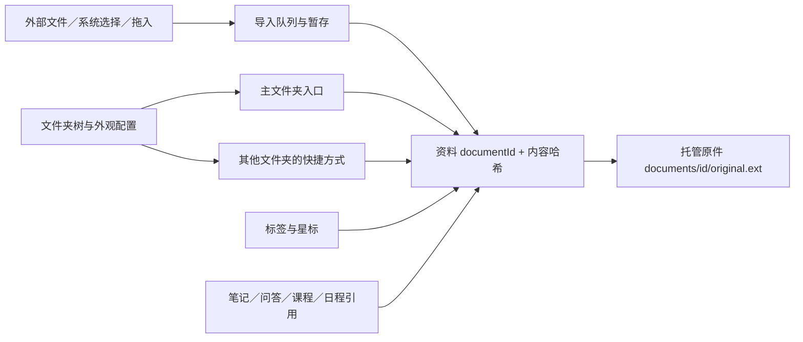

# Quelyt 资料库与文件管理系统实施计划

调研与编写日期：2026-11-09。状态：待实施方案。

本轮目标：取消导入前必须选择“教材／论文”的步骤，让用户直接加入材料，再通过自己的文件夹树、颜色、图标和标签整理；补齐批量导入、拖拽、移动、重命名、查找、删除恢复和备份能力，并保持已有笔记、问答、课程与日程引用稳定。

**推荐方案：沿用现有“书库”入口，升级为本地资料管理工作区；采用“一个主文件夹位置＋资料快捷方式＋标签”，以稳定资料 ID 连接所有学习数据。文件夹是应用内的分类树，整理文件夹不搬动底层原件。**

本计划基于当前工作区代码与成熟产品的官方文档调研。本次没有运行新功能、改变用户资料或执行数据迁移；引用的产品行为与 Quelyt 的设计建议分别说明。

## 1. 这次具体解决什么

| 用户需求 | 本轮交付行为 |
| --- | --- |
| 不想先给资料定类型 | 点击导入或拖入文件即可入库；没有教材／论文必选弹窗 |
| 自己建文件夹分类 | 新建、重命名、嵌套、移动、排序；支持完整分支树、面包屑与定位当前资料 |
| 自定义前端 | 文件夹颜色、图标或 emoji、分支线、颜色继承、列表／网格、密度、列显示和排序 |
| 方便拖入材料 | Windows 外部文件及文件夹拖入；内部文件、文件夹、多选项目拖动归档；始终有菜单替代入口 |
| 能删除不需要的资料 | 先移入回收站，可撤销及恢复；永久删除有明确影响范围，不删除用户原始外部文件 |
| 管理大量材料 | 多选、批量移动和标签、查重、导入队列、进度、失败重试、搜索和保存筛选 |
| 一份资料用于多个课程 | 建立快捷方式，共享同一份原件、笔记和学习进度 |
| 整理后还能继续学习 | 移动、改名、改颜色不改变资料 ID，课程和引用仍回到同一资料与页码 |
| 数据可带走、可恢复 | 导出原件或文件夹结构；整库备份与恢复包含分类和学习数据 |

本轮“完备”指学习资料的管理闭环。云同步、多人权限、系统磁盘管理、外部目录实时同步和任意格式编辑另行规划；它们不作为这套本地文件管理的前置条件。

## 2. 成熟方案调研与取舍

| 参照 | 官方文档确认的做法 | Quelyt 采用什么 |
| --- | --- | --- |
| Obsidian 文件浏览器 | 支持层级目录、新建、改名、拖动、右键菜单、排序和定位当前文件 | 借鉴目录树、面包屑、菜单与拖拽互补的交互；原件仍由 Quelyt 管理。[官方说明](https://obsidian.md/help/plugins/file-explorer) |
| Zotero 分类与标签 | 分类可以嵌套，同一条目可以属于多个分类；支持标签、未分类项目、保存搜索及回收站 | 借鉴资料与分类分离、标签和智能视图；Quelyt 的跨文件夹引用明确显示为快捷方式。[官方说明](https://www.zotero.org/support/collections_and_tags) |
| Zotero 文件保存 | 默认将文件复制到自身数据目录，另有链接外部文件的模式 | 沿用当前复制入库模式，保障外部文件改名、移动后仍能学习。[官方说明](https://www.zotero.org/support/attaching_files) |
| Google Drive 文件整理 | 支持文件夹颜色、星标、拖动、详情与快捷方式；删除快捷方式不删除目标文件 | 借鉴颜色、快捷方式和“定位原资料”；把移动、删除入口、删除资料的含义写清楚。[官方说明](https://support.google.com/drive/answer/2375091?hl=en) |

以下是针对 Quelyt 的设计判断：用户期待像文件管理器一样“把资料移到一个地方”，因此主位置采用单一归属；多学科复用通过快捷方式完成，标签承担交叉分类。这样既能保留熟悉的移动语义，也能避免复制出多套独立的阅读进度。

三种组织对象各自负责一件事：

- **文件夹**：主要归档位置，例如“大三上／高分子化学／教材”。
- **标签**：跨目录筛选，例如“待看、考试重点、结构化学、英文”。
- **快捷方式**：在另一文件夹放置同一资料的入口，例如把同一本教材放进“期末备考”的材料清单。

“全部资料、最近打开、未归档、星标、智能文件夹”是视图，不是另一个实际存储位置。

## 3. 当前代码基础与必须处理的差距

| 当前情况 | 代码依据 | 改造要求 |
| --- | --- | --- |
| 导入前弹出教材／论文选择，随后只允许选一个文件 | [study_app.dart](D:/Documents/Codex/辅助学习的agent/lib/ui/study_app.dart)、[app_dialogs.dart](D:/Documents/Codex/辅助学习的agent/lib/ui/dialogs/app_dialogs.dart) | 去掉分类前置步骤，统一文件选择、拖入和批量导入入口 |
| 导入完成会立即打开该资料 | [app_controller.dart](D:/Documents/Codex/辅助学习的agent/lib/app_controller.dart) | 导入与打开分离；批量导入留在当前文件夹，完成后提供“打开” |
| `DocumentKind` 只有 textbook、paper，若干界面直接据此分支 | [models.dart](D:/Documents/Codex/辅助学习的agent/lib/core/models.dart)、[learning_panel.dart](D:/Documents/Codex/辅助学习的agent/lib/ui/learning_panel.dart) | 分开文件格式、用户分类、学习方式，新增未指定分类的正常路径 |
| 原件已按资料 UUID 保存到托管目录，并计算 SHA-256 | [document_service.dart](D:/Documents/Codex/辅助学习的agent/lib/services/document_service.dart) | 保留稳定原件地址；文件夹移动只更新数据库关系 |
| 同哈希资料会返回已有条目，但没有针对归档目标的完整提示 | 同上 | 查重时明确“已存在、放在哪里、是否建立快捷方式”，不能静默改变旧资料归属 |
| 书库以教材／论文筛选，搜索仅匹配标题 | [library_page.dart](D:/Documents/Codex/辅助学习的agent/lib/ui/pages/library_page.dart) | 换成目录、标签、文件格式、处理状态等筛选；接入全文检索 |
| 资料删除会删除数据库记录、托管文件和缓存，并影响关联数据 | [local_store.dart](D:/Documents/Codex/辅助学习的agent/lib/core/local_store.dart)、[document_service.dart](D:/Documents/Codex/辅助学习的agent/lib/services/document_service.dart) | 先实现软删除和恢复，永久删除另走清理通道 |
| 已有日程材料、知识点、课程及整书问答依赖资料 ID | [schema.dart](D:/Documents/Codex/辅助学习的agent/lib/core/migrations/schema.dart) | 逐一接入资料生命周期，防止删除后继续检索、恢复后链接失效 |
| 当前数据库版本为 7，已经有迁移前备份机制 | [local_store.dart](D:/Documents/Codex/辅助学习的agent/lib/core/local_store.dart) | 复用迁移体系，实施时核对最新版本，不与其他迭代抢占版本号 |

这不是只增加一个文件夹组件。导入链路、资料身份、学习模式和删除恢复必须一起改，才能让文件管理可持续使用。

## 4. 不再要求用户选择材料类型

### 4.1 分开三个概念

| 概念 | 谁决定 | 用在哪里 |
| --- | --- | --- |
| 文件格式，如 PDF、PNG | 从文件内容和扩展名验证 | 决定读取方式、预览和解析能力 |
| 用户分类，如教材、论文、考纲、真题或自定义标签 | 用户导入后按需填写，可完全不填 | 文件夹、标签、搜索和展示，不限制学习功能 |
| 学习方式，如阅读问答、教材自学、论文精读 | 用户进入相关学习功能时选择或切换 | 决定当次教学界面与提示词，不决定资料放在哪个文件夹 |

新资料默认直接进入“阅读与问答”，不弹另一份“请选择类型”的补偿表单。教材自学、论文精读作为阅读器中的可见功能入口，按需要启用。AI 建议的用途最多作为可接受或忽略的建议，不能自动搬文件夹，也不能因导入而自动产生模型费用。

### 4.2 兼容旧资料

1. 旧 textbook、paper 信息保留，并映射为原有学习方式偏好；原来的学习会话按原流程恢复。
2. 新资料没有学习方式偏好时，使用显式的通用阅读问答路径，不能落入“不是教材就算论文”的旧二分逻辑。
3. 通用问答沿用整份资料检索能力；“论文精读”保留原文核查流程。切换方式不能清空笔记、问答和作答记录。
4. 初期可保留旧 `kind` 作为兼容字段，并增加未指定值；业务路由逐步改读学习方式。新增值需要同步调整序列化、迁移、导出与所有条件判断，不能仅修改枚举。
5. 不从文件夹名称、颜色或标签推断强制学习方式。“论文”文件夹也可以放教材或考纲。

### 4.3 文件格式范围

首轮继续确保 PDF、JPG、JPEG、PNG 的导入、预览与已有学习能力完整可用。拖入整个目录时，不支持的文件列入结果清单，明确“未导入”和原因，不能默默漏掉。

扩展阶段增加 TXT、Markdown、DOCX、PPTX、EPUB 等。每种格式分别标注“可保存、可预览、可搜索、可用于 AI”四项能力；不能将 Office 文件当成图片打开，也不能用虚假的页码让它通过现有阅读器校验。新增格式有单独适配和验收，不阻塞首轮文件管理。

## 5. 书库页面与文件夹分支树

### 5.1 页面结构

在当前全局侧栏中，书库选中时显示资料导航和文件夹树；避免再嵌套一整套重复的全局侧栏。日程和复习保持原入口。

```text
┌─────────────────────┬─────────────────────────────────────────────────┐
│ Quelyt              │ 书库       [查找资料… 当前文件夹 ▾] [+ 导入 ▾] │
│ 书库 ● 日程 复习    ├─────────────────────────────────────────────────┤
│                     │ 全部文件夹 > 大三上 > 高分子化学              │
│ 全部资料            │ [新建文件夹] [排序 ▾] [筛选] [列表／网格]     │
│ 最近打开            ├──────────────────────────────────┬──────────────┤
│ 未归档              │ 名称             标签    状态    │ 资料详情     │
│ 星标                │                                  │              │
│                     │ ▸ 教材                           │ 封面／预览   │
│ 文件夹          ＋  │ ▸ 真题                           │ 名称、格式   │
│ ▾ 大三上            │ □ 课堂讲义.pdf   考试重点 已就绪 │ 文件夹位置   │
│   ├─▾ 高分子化学    │ □ 结构示意.png   待看     识别中 │ 标签、说明   │
│   │   ├─ 教材       │ □ ↗ 参考教材.pdf         快捷方式│ 关联计划     │
│   │   └─ 真题       │                                  │ [阅读] [···] │
│   └── 概率论        │ 可拖入文件；空白处右键新建文件夹 │              │
│ ▸ 期末备考          ├──────────────────────────────────┴──────────────┤
│                     │ 已选择 3 项  [移动] [加标签] [移入回收站]     │
│ 智能文件夹          ├─────────────────────────────────────────────────┤
│ ▸ 待识别资料        │ 导入中：8/12   已存在 2   失败 1  [查看队列] │
│ 回收站              │                                                 │
└─────────────────────┴─────────────────────────────────────────────────┘
```

右侧详情默认可收起，不与日程详情共用内容状态。导入队列在有任务时显示，结束后可以收拢为状态入口。

### 5.2 文件夹树必须具备的能力

- 新建同级文件夹、子文件夹，行内重命名，移动到其他位置。
- 展开／收起单个分支、展开当前分支、全部收起；重启后恢复展开状态与选中位置。
- 显示层级线和当前选中路径；打开资料时可“在文件夹中定位”。
- 支持名称排序、手动顺序；只有手动顺序模式下显示拖动排序标记。
- 拖到文件夹中心表示移入；拖到同级节点间的插入线表示排序，二者有不同反馈。
- 悬停约 600 毫秒展开目标文件夹，接近边缘自动滚动；Escape 可取消拖动。
- 在界面和存储层都禁止把文件夹放入自身或后代，不能只靠拖动手势判断。
- 支持多层嵌套，不做三层之类的产品限制；技术防护可设最大 64 层，目录扫描及移动先检查完整子树深度，超限时解释原因。
- 树节点默认显示直属项目数；如提供包含子目录的数量，必须明确标注。快捷方式按入口计数，“全部资料”按真实资料去重计数。

文件夹使用稳定 ID，名称不参与身份判断。同一父目录下的文件夹名称规范化后不能重复；重命名冲突时提供修改名字或取消，不自动合并整棵树。

### 5.3 列表、网格与选中行为

桌面默认单击选中，双击或 Enter 打开；提供明确的阅读按钮。Ctrl 多选、Shift 连选、Ctrl+A 选中当前结果；操作始终显示项目数量。切换文件夹或筛选时清空不可见选择，避免意外处理隐藏项目。

手机点击打开，长按进入多选。移动、重命名、标签和删除都能从菜单完成，拖拽是快捷方式，不是唯一操作手段。

列表默认显示名称、格式、阅读进度、最近打开与处理状态；用户可增减标签、页数、大小、导入日期等列。名称、原始文件名、扩展名分别保存：改显示名不改变文件格式，也不改用户外部原文件。

网格显示封面或首图、名称、少量标签和状态；缩略图异步加载并缓存。大文件夹使用虚拟列表／网格，不能一次构建所有资料卡。

## 6. 文件夹颜色与自定义外观

### 6.1 首轮可自定义项目

| 项目 | 交互规则 |
| --- | --- |
| 文件夹颜色 | 提供约 12 个预设色、默认色和自定义 HEX；改变图标与少量强调元素，正文保持可读 |
| 图标 | 从现有图标体系中选择，或使用单个 emoji；保存图标标识，缺失时回退为普通文件夹 |
| 分支颜色 | 可跟随文件夹颜色，也可使用统一中性色；提供显示／隐藏分支线 |
| 子文件夹继承 | 新建时可继承父颜色；保存“继承”状态，而非复制颜色值；父颜色变化只影响未单独覆盖的后代 |
| 密度 | 舒适／紧凑；图标、点击区域与文字不能缩到难以操作 |
| 排序和视图 | 每个文件夹记住列表／网格、排序字段与方向；全局默认供新文件夹使用 |
| 侧栏宽度 | 可拖动调整，限制合理最小／最大宽度；窄屏自动切为抽屉 |
| 文件夹说明 | 可写用途和短说明，详情区展示；可选封面作为后续增强 |

提供“恢复此文件夹默认外观”和“恢复全局默认布局”，均不改变材料和分类。颜色不承担唯一信息表达；绿色文件夹不自动表示“完成”，红色不自动表示“有错”。

继承关系示例：

```text
大三上：蓝色
├─ 高分子化学：继承 → 蓝色
│  ├─ 教材：继承 → 蓝色
│  └─ 真题：自行设为橙色 → 保持橙色
└─ 概率论：自行设为紫色 → 保持紫色

大三上改为绿色后：高分子化学、教材跟随；真题和概率论保持自定义颜色。
```

沿用当前主题 token 和 QIcons 图标体系。自定义保存为结构化配置，不开放任意脚本或 CSS；这样桌面与手机都能稳定恢复同一套分类外观。

## 7. 导入、拖拽与批量处理

### 7.1 一个统一导入入口

“选择文件、选择文件夹、外部拖入”进入同一条队列，使用相同的校验、查重、错误和恢复规则。后续剪贴板图片导入也接入此队列。

| 所在位置 | 默认导入目标 |
| --- | --- |
| 一个真实文件夹 | 该文件夹 |
| 拖到树上的真实文件夹 | 高亮的目标文件夹 |
| 全部资料、最近打开、星标、标签筛选、智能文件夹 | 未归档；界面清楚显示目标，可修改 |
| 回收站 | 不接收导入；提供返回书库入口 |

资料导入后即可出现在书库，标明“待处理／可阅读／识别中”等真实状态。批量导入不逐份打开阅读器，不因其中一份失败而撤销已成功项目。

### 7.2 外部文件与目录

1. 拖入单个或多个文件：显示“导入到 ××”，松手后排队复制入库。
2. 拖入目录：先扫描并显示文件数、支持数、总大小和目标位置；默认保留目录结构，用户可改为全部放入一个文件夹。
3. 同时选择父目录和其子文件时，规范化来源并去重，防止导入两遍。
4. 目录扫描不跟随符号链接／目录联接无限递归，不自动扫描目标之外的磁盘；不可读项目列入清单。
5. 同名目标文件夹逐个决定合并内容或建立新文件夹。默认提供改名后的新文件夹，不静默合并已有分类。
6. 扫描遇到大量项目、尚未确定总数时显示已发现数量，不展示虚构的百分比。用户可以取消。
7. 导入目标在处理中被删除时暂停相关项目，允许选择新目标或取消，不悄悄放进另一个目录。

外部拖入始终复制到 Quelyt，用户磁盘上的原件不随移动、重命名或删除而变化。

### 7.3 内部拖动与快捷方式

| 操作 | 结果 |
| --- | --- |
| 主资料拖到另一个真实文件夹 | 移动主位置，资料 ID、原件和学习记录不变 |
| 快捷方式拖到另一个文件夹 | 只移动这个快捷方式 |
| 选择“添加快捷方式到…” | 在目标位置建立引用，显示箭头标记，共享原资料数据 |
| 文件夹拖到另一文件夹 | 移动整棵子树，保持子项身份和相对结构 |
| 同时选中父文件夹与子项后移动 | 合并成最小操作集合，不重复处理子项 |
| 拖到当前位置、自己或后代 | 不提交无效操作，并说明原因 |
| 拖到标签、星标或智能文件夹 | 首轮不隐式执行文件夹移动；使用对应“加标签／星标”操作 |

快捷方式不能指向另一个快捷方式，统一解析到资料 ID；首轮只做资料快捷方式，不做文件夹快捷方式，避免树中出现引用环。

移动结果提供撤销。同批次移动是一个事务；目标冲突尚未解决时不先搬走一半。跨多个源文件夹移动前显示来源数量与目标，完成后保持选择并可定位。

### 7.4 查重与同名规则

| 情况 | 默认处理 |
| --- | --- |
| 名称相同、内容不同 | 保留两份，显示格式、大小、日期帮助区分；不自动覆盖 |
| 内容相同、目标就是原主位置 | 记为已存在，提供定位；不复制文件、不重新 OCR |
| 内容相同、目标是另一文件夹 | 在当前批次摘要中说明将建立快捷方式；原位置与进度保留 |
| 内容相同、目标已有快捷方式 | 记为已存在，不重复创建入口 |
| 相同内容在回收站 | 提供恢复到目标位置或跳过，不悄悄产生新资料或自动恢复 |
| 同名的新版本教材 | 新资料 ID 和新版本关系；旧页码、笔记、作答不自动移植 |

重复判断基于托管副本的哈希，不以文件名相同判定重复。现有历史重复资料若各自有笔记，先展示并交由用户决定，不能迁移时直接归并。

### 7.5 导入队列

每项分别保存：来源名称、目标文件夹、字节进度、状态、成功资料 ID 或失败原因。状态包含等待、复制、校验、已存在、已入库、失败、取消；OCR 是入库后的独立处理状态。

队列支持取消未完成项目、重试失败项、定位成功项目和查看结果清单。应用关闭后，已暂存完整文件可以继续；来源权限已失效而尚未复制完的项目提示重新选择，不能声称重启后一定仍能读取来源。

磁盘空间不足、文件被占用、权限失效、加密 PDF、损坏文件、不支持格式分别给出可理解的原因。已入库资料不随“取消剩余导入”被删除。

## 8. 日常文件操作与查找

### 8.1 菜单能力

资料菜单提供：阅读、预览、重命名、移动到、创建快捷方式、星标、标签、详情、导出原件、移入回收站。快捷方式增加“定位原资料”，删除文案改为“删除此快捷方式”。

文件夹菜单提供：新建子文件夹、重命名、移动、颜色与图标、排序、搜索此文件夹、导出、移入回收站，以及单独的“解散文件夹并保留资料”。

“解散”把直属子文件夹、主资料和快捷方式提升到父级，先预览命名冲突，整体提交；“移入回收站”则处理文件夹及内容，二者不可共用含糊的“删除”按钮。

复制到其他文件夹优先使用明确的“创建快捷方式”。若以后提供“复制为独立资料”，要另建资料身份并说明哪些学习数据会复制，不把快捷方式伪装成独立副本。

### 8.2 键盘与撤销

首轮支持 Enter 打开、F2 重命名、Delete 移入回收站、Ctrl+A 多选、Ctrl+X／Ctrl+V 移动、Ctrl+Shift+N 新建文件夹、Escape 退出选择或拖动。文本框获得焦点时，这些按键遵循文本编辑语义。

Ctrl+Z 在文件列表聚焦时撤销最近一次可逆的移动、重命名、颜色修改或移入回收站；输入框聚焦时撤销文字。已发生冲突或后续修改的操作给出原因，不能覆盖新状态。永久删除不提供虚假的撤销。

### 8.3 搜索、筛选与智能文件夹

- 搜索标题、原始文件名、文件夹名、标签和说明。
- 可切换当前文件夹、包含子文件夹、全部资料；范围直接显示在输入区。
- 全文搜索复用已有本地 FTS，返回片段和真实页码；点击跳到资料原页。
- 可筛选文件格式、标签、导入日期、阅读状态、处理状态和关联学习计划。
- 未完成 OCR 时显示全文覆盖不足；“暂时找不到正文”不能显示成“材料没有该内容”。
- 保存当前筛选为智能文件夹，如“未读且标记考试重点”“识别失败的扫描资料”。保存的是查询条件，结果随实际数据更新。
- 智能文件夹清楚标识，不可接收内部“移动到这里”；搜索结果中的移动使用真实资料身份和原位置。
- 全部资料、全局搜索默认不重复列出同一资料的快捷方式；真实文件夹内显示其实际入口。

快速搜索与全文搜索均默认排除回收站。回收站有独立搜索，不能让已经删除的教材片段继续参与普通问答。

## 9. 删除、回收站、恢复与学习引用

### 9.1 默认删除规则

| 用户动作 | 应用内结果 | 外部原文件 |
| --- | --- | --- |
| 删除资料主入口 | 资料移入回收站；其他快捷方式显示“资料在回收站”并提供恢复 | 不变 |
| 删除快捷方式 | 只把这一入口移入回收站；原资料和其他入口仍可用 | 不变 |
| 删除文件夹 | 文件夹及其主资料、子目录、快捷方式按同一批次入回收站；快捷方式目标若在外部则保留 | 不变 |
| 解散文件夹 | 内容提升到父级，资料继续可用 | 不变 |
| 恢复资料／文件夹 | 恢复原位置和关系；位置不可用时显示恢复目的地 | 不变 |
| 永久删除资料 | 删除托管原件及明确列出的资料专属数据，清理或失效关联引用 | 不变 |

非空文件夹删除前展示资料数、子文件夹数、外部快捷方式与关联学习计划影响。普通资料软删除后提供即时撤销。首轮回收站不自动清空；未来若增加保留天数，由用户自行启用，并清楚展示到期规则。

### 9.2 恢复规则

1. 文件夹恢复优先以整个删除批次恢复子树，不丢颜色、图标、手动顺序与快捷方式关系。
2. 单独恢复其中一份资料时，若祖先仍在回收站，提供“恢复原路径”或“选择目标文件夹”，不恢复到不可见位置。
3. 原位置被永久删除时默认建议未归档，并允许改目标；名称冲突时保留双方并显示恢复后的名字。
4. 恢复原资料 ID、哈希与已有解析结果；通过生命周期版本使旧异步操作失效，避免“删除前的晚到响应”在恢复后错误写回。
5. 回收站入口、原资料状态和日程中的材料提示一起更新；恢复后无需重新绑定原任务。

### 9.3 与已有学习功能的关系

| 操作 | 笔记、问答、课程、日程的行为 |
| --- | --- |
| 移动、改名、改色、改标签 | 全部继续有效；显示名更新，资料 ID 和页码引用不变 |
| 建立快捷方式 | 共享同一份阅读进度、笔记与教材问答；计划仍绑定原资料 ID |
| 移入回收站 | 保留数据供恢复；暂停相关处理，普通检索和新 AI 请求不可读取该资料；已安排任务显示“材料在回收站” |
| 恢复 | 校验原件后重新启用引用；按需恢复处理队列，不能重复生成课程 |
| 永久删除 | 清理该资料的原件、页面、OCR、笔记、资料会话和整书理解／问答；独立日程与实际学习记录保留，教材入口变为已删除 |

永久删除还要检查课程中缓存的教材片段、来源快照与生成内容，按“资料派生内容”和“用户独立学习记录”分别处理：派生课程不可再作为有效教材课程使用，并清理其资料缓存；实际学习结果与用户已提交作答保留，来源标明已删除。删除预览把这两个范围分别列出，不能只删除 `documents` 行就宣称所有关联已处理。

软删除不调用当前会级联清理数据的 `deleteDocument()`。新建 `trash / restore / purge` 三个明确操作，旧永久删除恢复日志也单独兼容，不把回收站项目写入旧 `pending-delete` 队列。

## 10. 导出、备份、恢复和存储管理

### 10.1 导出资料

支持导出选中原件或整个文件夹结构。导出到用户指定位置，文件名由显示名和原格式生成；处理重名、Windows 保留名及不合法字符，并给出映射清单。

导出包含快捷方式时可选择“导出对应原件”或“只导出引用清单”，明确是否会在多个目录复制同一内容。禁止导出过程中覆盖源资料或递归写入正在导出的目录。导出失败保留失败明细和已完成结果，不冒充全部成功。

原件导出不等于学习数据备份。页面用不同按钮和说明区分。

### 10.2 完整备份

备份包含原件、数据库、文件夹树、颜色和图标、标签、快捷方式、笔记、问答、学习与日程记录、必要视图设置；回收站内容默认包含，可由用户排除。可重建缩略图和渲染缓存不必打包，API Key 不进入备份。

复用现有数据库快照能力。SQLite 官方说明 `VACUUM INTO` 可生成一致性数据库副本，但中途中断的输出可能不完整，因此备份必须校验并在完成后标记成功。[SQLite 文档](https://www.sqlite.org/lang_vacuum.html)

跨数据库和文件的备份需要一致性边界：取得数据库快照和所引用原件清单，备份期间阻止这些原件被永久清理，按哈希核对文件。完成后生成版本、文件数、总大小和校验清单；不能只复制一个仍在写入的数据库文件。

### 10.3 恢复与空间管理

首轮提供整库恢复，不自动合并两套可能存在 ID 冲突的资料库。先在临时目录校验包格式、路径、哈希、数据库版本及完整性，再备份当前库、关闭文件句柄并切换；失败保留原库，支持恢复到切换前状态。

备份清单使用资料 ID 和相对路径。恢复到另一台电脑或 Android 时，根据新托管目录重建文件地址，不沿用数据库里原电脑的绝对路径；资料 ID、哈希和页码引用保持不变。两端不适用的窗口尺寸或布局设置采用本端默认，模型凭据重新配置。

设置页显示原件、可重建缓存、回收站分别占多少空间。提供“清理可重建缓存”和“查看回收站”，避免把清理缓存变成删除资料、OCR 校正或学习记录。处理原件缺失时显示修复入口；相同哈希可重新链接，内容不同则走新版本流程。

## 11. 技术落地方案

### 11.1 依赖与平台

继续使用 Flutter、SQLite 和现有托管文件目录。内部拖动使用 Flutter 的 `Draggable / DragTarget`，外部文件拖入单独接平台能力，不能用内部拖动组件假装已经支持资源管理器拖入。[Draggable](https://api.flutter.dev/flutter/widgets/Draggable-class.html)、[DragTarget](https://api.flutter.dev/flutter/widgets/DragTarget-class.html)

现有 `file_picker 10.3.10` 已提供多文件和目录选择能力，先复用当前版本，避免为本次功能整体升级依赖。[对应版本文档](https://pub.dev/packages/file_picker/versions/10.3.10)

外部拖入候选为 `desktop_drop 0.9.2`。发布页要求 Flutter 3.47.7 / Dart 3.13.5 以上；工作区工具链元数据为 Flutter 3.47.9 / Dart 3.13.7，满足其声明的最低版本。仍需先做 Windows 多文件、目录及 Android 来源权限验证，再锁定依赖；本次未验证插件构建或运行。[发布页](https://pub.dev/packages/desktop_drop)

Android 采用系统文件选择和 Storage Access Framework，不假定总能取得稳定磁盘路径；导入器接收可读流、名称和元数据。目录权限与桌面路径不同，需要单独适配和实机验收。[Android 官方说明](https://developer.android.com/training/data-storage/shared/documents-files)

该拖入插件也说明文件／目录可能没有本地路径，部分平台的来源访问只在回调期间有效。因此要在权限有效期间暂存到托管区域，不能仅保存来源字符串并承诺以后一定能读取。[插件读取规则](https://pub.dev/packages/desktop_drop)

### 11.2 身份和存储模型



| 对象 | 建议新增或扩展的数据 | 约束 |
| --- | --- | --- |
| 资料 | 继续保留 documentId、哈希、托管路径；增加原文件名、格式、大小、可选学习方式偏好、生命周期状态与版本 | 移动、改名不改变身份；内容改变必须新版本 |
| 文件夹 | id、parentId、name／规范化名称、sortKey、颜色模式与值、图标、说明、revision、删除批次 | 父节点有效、禁止环、同级文件夹重名受控 |
| 资料入口 | id、folderId、documentId、主入口／快捷方式、可选快捷方式别名、sortKey、删除批次 | 每份有效资料恰有一个主入口；同一目录不重复创建同资料入口 |
| 标签 | 标签 ID、名称、颜色，资料与标签的多对多关系 | 标签改名不改变关联；跨目录保持一致 |
| 星标与智能视图 | 目标稳定 ID、查询条件及版本 | 智能视图不复制资料，不接受目录移动 |
| 导入任务 | batchId、itemId、来源描述、暂存位置、目标、进度、状态、错误码、结果 documentId | 单项可重试，重复提交幂等 |
| 删除批次与操作日志 | 批次、选中根、原父级／顺序、影响项、状态、操作 ID | 恢复子树与撤销不能靠重新猜测位置 |
| 视图配置 | 当前位置、展开节点、排序、密度、列、网格大小、侧栏宽度 | 与内容分开保存，恢复默认不影响材料 |

“未归档”由主入口位于逻辑根目录的有效资料派生。“全部资料”按 documentId 去重；“文件夹内容”按入口查询。快捷方式与主资料共享标签和进度；快捷方式别名只影响该入口，原资料重命名则更新所有未自定义别名的入口。

首轮不把文件夹路径直接映射为磁盘目录，避免重命名影响已打开的 PDF 句柄和资料引用。未来若要外部文件夹同步，作为另一种存储模式单独设计。

### 11.3 导入与一致性

导入按“读取来源 → 暂存副本 → 校验格式和哈希 → 事务内查重 → 放置原件并提交资料／入口 → 后台解析”的顺序协调。文件系统与 SQLite 不是同一个事务，必须通过任务日志记录各阶段，重启时处理未提交暂存文件、已落盘未登记文件和待重试项目。

哈希和大文件复制使用流及后台任务，不能将多个大 PDF 全部读入界面内存。默认限制并发处理数量，用户阅读和当前页解析优先于批量后台 OCR。

当前查重遍历全部资料，下一步改为哈希索引与事务内二次检查，串行提交导入结果，防止两次拖入同时创建重复项。历史重复资料先报告；若未来加唯一索引，必须先处理历史重复及其独立学习记录，不能直接删行满足约束。

文件夹移动使用带版本的操作计划，校验目标和最小选中集合后一次提交。重命名与阅读进度更新采用字段级写入或版本检查，避免后台保存旧 DocumentRecord 时覆盖用户刚改的名字。

### 11.4 软删除与异步任务

生命周期至少区分 active、trashed、purging。普通列表、搜索、教材理解、问答检索、课程材料和新建计划的候选材料统一只读 active；历史记录可显式读取其他状态并显示原因。

进入回收站时取消相关 OCR、整书理解和问答任务；提交前再次检查 documentId、哈希、生命周期版本。恢复要推进版本，不能让删除前发起的响应趁恢复后重新写入。

若资料正在阅读或作答，先保存用户草稿，再退出相关页面并更新入口状态；保存失败时停止这次删除，保留输入并说明原因。对同一资料的多个快捷方式执行批量删除时，按主资料与入口分别计算影响，不能重复触发清理。

永久清理采用持久化阶段日志：停止使用 → 标记不可恢复清理中 → 处理关联数据 → 释放句柄并删除托管原件／缓存 → 完成。中途失败显示具体状态并重试，不能一边声称已彻底删除，一边仍能打开原件。路径只能指向已校验的托管目录，不能借用户显示名拼接删除路径。

### 11.5 代码组织

| 位置 | 计划改造 |
| --- | --- |
| [library_page.dart](D:/Documents/Codex/辅助学习的agent/lib/ui/pages/library_page.dart) | 分拆树、面包屑、结果列表、详情、选择工具栏与队列；不继续扩大一个页面的全部职责 |
| [app_shell.dart](D:/Documents/Codex/辅助学习的agent/lib/ui/shell/app_shell.dart) | 接入书库专属导航、树区域和宽度状态 |
| [study_app.dart](D:/Documents/Codex/辅助学习的agent/lib/ui/study_app.dart) | 去除导入类型前置流程，明确当前位置与导入目标 |
| [app_controller.dart](D:/Documents/Codex/辅助学习的agent/lib/app_controller.dart) | 导入不再必然打开；接入删除生命周期，阅读控制与文件管理控制解耦 |
| [models.dart](D:/Documents/Codex/辅助学习的agent/lib/core/models.dart) | 兼容未指定分类与学习方式偏好，保留旧资料身份 |
| [document_service.dart](D:/Documents/Codex/辅助学习的agent/lib/services/document_service.dart) | 流式导入、校验和托管文件；拆分入回收站与永久清理，继续保护原始外部文件 |
| [local_store.dart](D:/Documents/Codex/辅助学习的agent/lib/core/local_store.dart)、[schema.dart](D:/Documents/Codex/辅助学习的agent/lib/core/migrations/schema.dart) | 新增关系与生命周期，统一查询范围、迁移和索引 |
| [reader_page.dart](D:/Documents/Codex/辅助学习的agent/lib/ui/reader/reader_page.dart)、[learning_dock.dart](D:/Documents/Codex/辅助学习的agent/lib/ui/reader/learning_dock.dart) | 去除教材／论文二分默认，增加按需切换学习方式 |
| [book_qa_controller.dart](D:/Documents/Codex/辅助学习的agent/lib/features/book_qa/book_qa_controller.dart) 与日程模块 | 生命周期检查、删除恢复提示、稳定资料引用 |
| [tokens.dart](D:/Documents/Codex/辅助学习的agent/lib/ui/theme/tokens.dart) 与现有图标体系 | 增加文件夹外观配置层，沿用全局主题 |

建议新增独立的 `LibraryController`、`LibraryRepository`、`ImportQueue`、`TrashService` 和 `BackupService`，通过清楚的接口调用现有阅读与学习模块。展示状态与文件操作分开，避免拖动中的悬停事件直接改数据库。

## 12. 旧资料迁移方案

1. 记录当前数据库版本、资料数量、托管文件和关联记录数量；使用现有迁移前备份机制，验证备份可打开。
2. 新增表和字段，保留旧资料 UUID、哈希与托管路径；不重新复制原件，不重新 OCR。
3. 给每份现存资料建立一个根目录主入口，统一出现在“未归档”。保留原教材／论文信息作为学习偏好，不擅自建两个永久分类目录。
4. 对旧数据的同名、同哈希和缺失原件生成诊断，不自动删除或合并有学习记录的资料。
5. 学习方式迁移兼容旧 session；对新“未指定”状态执行通用阅读路径的验证。
6. 将所有活动查询和异步提交接入生命周期。迁移完成后检查笔记、全文检索、问答、课程与日程的资料引用。
7. 兼容已存在的永久删除待办日志，避免与新回收站混用；新 UI 的 Delete 不再调用旧永久删除入口。
8. 迁移失败回滚，不出现只迁移了部分文件夹、却已更新版本号的数据库。旧应用不能直接打开新库；回退使用迁移前备份及兼容版本，不能只降低版本数字。

迁移验收用隔离数据副本完成。实施时再次检查当前最新 schema，按实际版本继续递增。

## 13. 分步实施安排

估算以一名熟悉当前 Flutter 项目的开发者、可测试 Windows 和 Android 为前提：完整首轮约 **20–30 个工作日，分四次交付**。依赖、真实批量导入和备份恢复问题按实测调整；下表是实施顺序，不表示这些功能已经完成。

### 交付 A：建立稳定的数据和导入基础（约 5–7 天）

| 步骤 | 具体工作 | 验收产物 |
| --- | --- | --- |
| FM01 基线与设计契约 | 记录当前入口和数据关联；确定移动、快捷方式、删除、恢复与学习方式语义；准备含笔记／问答／日程的隔离样本 | 操作矩阵与迁移样本；确认不覆盖现有未提交开发 |
| FM02 平台拖入验证 | 锁定候选插件；测试 Windows 文件、目录、中文长名称、混合格式及 Android 文件来源；确认流和权限时效 | 两端能力记录；插件版本和不支持情形明确 |
| FM03 目录与生命周期模型 | 建立文件夹、入口、标签、生命周期和批次结构；实现父子检查、主入口唯一、基础查询 | 存储层可创建、移动、查询、软删除与恢复 |
| FM04 兼容迁移与类型解耦 | 原资料进入未归档；保留旧偏好；新增未指定分类阅读路径；检查所有 kind 分支 | 旧资料可继续学习，新资料不需要类型选择 |
| FM05 统一导入队列 | 导入与打开分离；多选、暂存、哈希查重、目标位置、逐项错误与重试 | 同一批文件成功与失败分别可见；取消不删除已入库资料 |

### 交付 B：完成文件夹管理和自定义界面（约 5–8 天）

| 步骤 | 具体工作 | 验收产物 |
| --- | --- | --- |
| FM06 树与面包屑 | 接入侧栏树、导航历史、展开恢复、当前资料定位和菜单 | 多层目录可用，切换和返回不丢位置 |
| FM07 列表与批量选择 | 列表／网格、单选多选、详情与批量工具栏；汇总查询取代逐条查笔记数 | 大量资料可滚动，选中数量与操作范围准确 |
| FM08 内外拖拽 | 文件／目录外部拖入；内部移位与排序；目标高亮、悬停展开、自动滚动、循环校验 | 拖拽和“移动到”产生相同结果，批量移动可撤销 |
| FM09 外观定制 | 颜色、图标、分支线、继承、密度、列显示、每文件夹视图与重置 | 重启保留配置；父颜色变化不覆盖自定义子颜色 |
| FM10 快捷方式与快捷操作 | 建立／移动／删除快捷方式；重命名、星标、标签；键盘及无拖拽替代入口 | 多文件夹共享一份资料和进度；删快捷方式不删原资料 |

这一阶段结束时，用户可以不选类型地批量导入、建立自己的彩色文件夹树并拖拽整理。回收站存储已有基础，最终删除与学习联动仍需交付 C 完成后才作为完整功能发布。

### 交付 C：补齐安全恢复、搜索和学习联动（约 6–9 天）

| 步骤 | 具体工作 | 验收产物 |
| --- | --- | --- |
| FM11 回收站与批次恢复 | 回收站列表、影响摘要、撤销、恢复子树、单项恢复、位置冲突和解散文件夹 | 删除可恢复完整分类与关联，普通删除不触发级联清理 |
| FM12 永久清理与异步隔离 | 清理阶段日志、文件句柄释放、OCR／问答取消与提交前检查、旧删除日志兼容 | 重启可续清理；晚到结果不复活已删除资料 |
| FM13 搜索与智能文件夹 | 元数据搜索、FTS 片段、范围筛选、处理覆盖提示、保存查询与去重 | 在文件夹或全库找到材料并跳到对应页；回收站不进入普通检索 |
| FM14 学习模块联动 | 原文跳转、教材问答、计划材料、课程、复习中的移动／删除／恢复状态 | 重命名移动不破坏学习；回收站与缺失材料有明确操作入口 |
| FM15 中断恢复与一致性 | 模拟导入中断、目标删除、空间不足、批量操作冲突、同哈希并发；加入字段级更新保护 | 无半条资料、丢失主位置或被后台覆盖的名称；失败可定位和重试 |

### 交付 D：数据可携带、跨端和发布验收（约 4–6 天）

| 步骤 | 具体工作 | 验收产物 |
| --- | --- | --- |
| FM16 导出与完整备份 | 导出原件／目录；数据库一致快照、原件清单、哈希验证、配置和记录打包 | 导出文件可打开，备份完整且不包含 API Key |
| FM17 恢复与空间管理 | 临时库验证、旧库备份与切换；缓存清理、空间分类、缺失原件修复 | 模拟恢复失败不损坏原库，成功恢复分类与学习数据 |
| FM18 Android 与可访问性 | 系统选择、长按多选、移动菜单、抽屉树、键盘遮挡、桌面键盘和缩放 | 两端核心操作完整；不依赖外部拖拽才能管理材料 |
| FM19 性能与故障回归 | 虚拟化、分页、聚合计数、后台哈希与缩略图；执行下节场景 | 提交可复查的性能与故障结果，未通过项目有说明 |
| FM20 文档与版本交付 | 更新帮助、实现说明、迁移与备份指南；检查安装包升级和首次启动 | 版本说明准确；已实现、未验收和后续扩展分开登记 |

下一阶段增强：更多格式适配、资料归档、独立副本、可配置属性字段、文件夹封面、人工审核的近似重复归并、外部目录关联。自动 AI 分类作为可选建议，仍不恢复为导入必填流程。

## 14. 验收清单

| 编号 | 场景 | 必须满足 |
| --- | --- | --- |
| FM-A01 | 导入 PDF 与图片 | 不要求选择教材／论文；可立即看到入库结果并按需阅读 |
| FM-A02 | 旧资料升级 | 文档 ID、原件、笔记、问答、阅读位置及日程绑定保持可用 |
| FM-A03 | 未指定学习方式 | 正常通用阅读问答；不误入论文或教材专属分支；旧会话按原方式恢复 |
| FM-A04 | 新建多层树、移动父节点 | 子树关系准确；移动到自身或后代被拒绝 |
| FM-A05 | 颜色和图标继承 | 继承节点跟随父级，自定义节点不被覆盖；重启仍一致 |
| FM-A06 | Windows 多文件、整目录拖入 | 目标高亮，目录结构保留；不支持与失败项明确列出 |
| FM-A07 | Android 系统选择与来源失效 | 无稳定路径也能复制支持的来源；权限过期可重新选择，已完成项目保留 |
| FM-A08 | 批量移动父子混合选中项 | 同一项仅处理一次；事务失败不留下半移动；可撤销 |
| FM-A09 | 内容相同、名称相同的不同组合 | 按查重表处理，不覆盖；快捷方式不制造第二套学习数据 |
| FM-A10 | 两个来源同时导入相同内容 | 提交后只新增一份真实资料，目标入口按策略处理 |
| FM-A11 | 改名、移动正在阅读的资料 | 阅读不中断，原文页码和笔记引用不变，后台进度不覆盖新名字 |
| FM-A12 | 删除快捷方式 | 原资料及其他入口可用，恢复只恢复该入口 |
| FM-A13 | 删除被其他目录引用的主资料 | 清楚提示影响；快捷方式显示回收站状态；恢复后自动可用 |
| FM-A14 | 删除非空目录再恢复 | 子树、颜色、排序、资料、快捷方式与学习关系完整恢复 |
| FM-A15 | 恢复时父目录不存在或重名 | 提供目标和冲突处理，不覆盖现存内容，不恢复到不可见位置 |
| FM-A16 | OCR／问答中删除，再恢复 | 旧请求不能写回新生命周期，恢复后可重新处理，学习数据不重复 |
| FM-A17 | 永久清理中退出再打开 | 有明确清理阶段并可续做，失败不虚报成功，外部原文件始终不变 |
| FM-A18 | 搜索当前目录、子目录、全库 | 范围正确，快捷方式按视图去重，已删除资料不参与普通搜索和 AI 检索 |
| FM-A19 | 资料部分 OCR 就绪 | 结果显示覆盖范围；未识别内容不被当作确认不存在 |
| FM-A20 | 导入时磁盘不足、文件损坏、取消 | 每项原因清楚，成功项保留，无半条资料；重试不会重复入库 |
| FM-A21 | 导出与备份恢复 | 导出原件可打开；恢复后分类、颜色、标签、笔记、问答和日程一致；不恢复凭据 |
| FM-A22 | 损坏备份或新版本备份 | 预检拒绝或明确要求兼容版本，不覆盖当前库 |
| FM-A23 | 键盘、窄屏与大字体 | 无鼠标也能移动、改名、删除恢复；触控目标至少 44；主要操作不被遮挡 |
| FM-A24 | 大资料库与长目录 | 10,000 条资料、1,000 个目录、20 层树、100 项批量导入可操作；界面不等待全部哈希或 OCR 后才响应 |

性能测试记录同一台基线设备、冷／热启动、索引覆盖和资料大小。建议目标：热状态切换文件夹首屏 200 毫秒以内、标题／标签搜索首屏 500 毫秒以内，初测后按设备能力修订；外部磁盘复制、全文索引和 OCR 单独记录，不能计入“已完成导入”的虚假进度。

自动化重点覆盖迁移、树环与批量操作、重复导入、生命周期、晚到响应、恢复、文件路径边界和备份一致性。颜色、间距等低风险外观变化采用视觉检查。发布前继续运行与本次变化有关的原阅读、资料删除、日程及教材问答回归；不以界面截图代替数据完整性验证。

## 15. 与其他方案的关系

- [企划](D:/Documents/Codex/辅助学习的agent/企划.md)：登记本轮资料管理升级。以下历史“教材／论文”固定分类不再是导入前置要求。
- [教材问答调整方案](D:/Documents/Codex/辅助学习的agent/教材问答调整方案.md)：文件夹不会自动成为问答检索边界；整份资料问答能力与用户分类分离。
- [第二版日程实施计划](D:/Documents/Codex/辅助学习的agent/第二版日程实施计划.md)：计划材料继续绑定稳定资料 ID，不能绑定文件夹路径或显示名。
- [日程与每日学习前端对齐方案](D:/Documents/Codex/辅助学习的agent/日程与每日学习前端对齐方案.md)：资料管理与学习工作区共用来源、恢复和生命周期规则，界面状态分别保存。

开工顺序优先 FM01–FM05。先保证“无需类型即可导入、身份稳定、可恢复的数据关系”，再把树、颜色和拖拽接到同一套操作上；完整发布以四次交付及上述验收完成为准。
